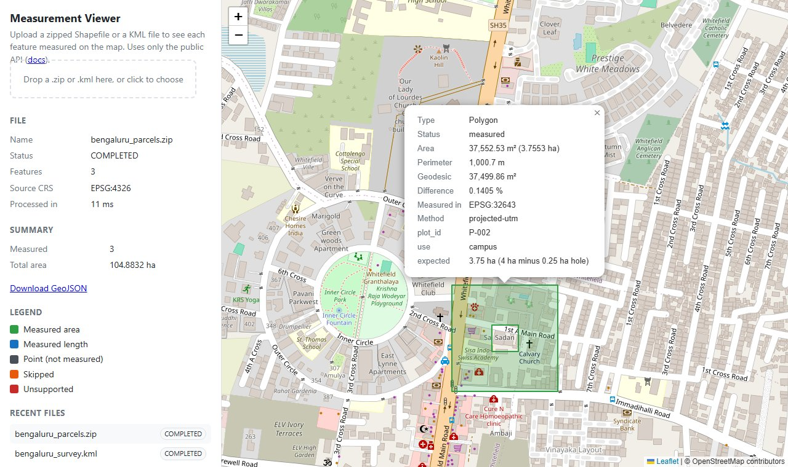
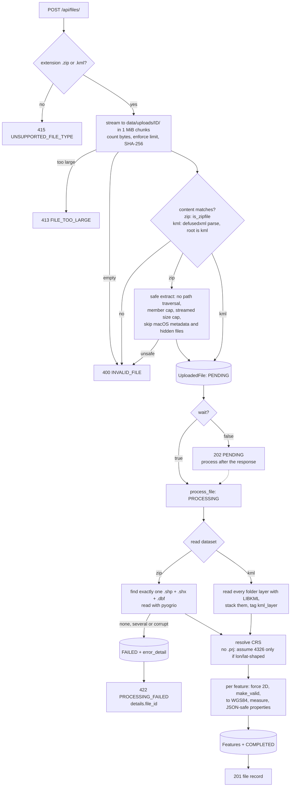
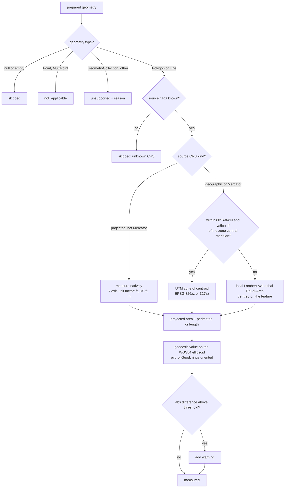

# Geospatial File Measurement API

A FastAPI service that accepts a **zipped Shapefile** or a **KML** file, extracts every feature,
and returns **area** for polygons and **length** for lines. Each value is computed in a projected
CRS chosen per feature, and then cross-checked against the exact geodesic value on the WGS84
ellipsoid.



*The bundled map viewer, which uses only the public API. Parcel P-002 is a 200 m square with a
50 m courtyard. It measures 37,552.53 m² in UTM 43N against a geodesic 37,499.86 m²; the 0.14%
difference is UTM's known scale error at this distance from the zone's central meridian.*

**Highlights**

- **Never measures in degrees.** Each feature is projected to its own UTM zone. An equal-area
  fallback covers polar and very wide features, and Web Mercator input is detected and
  reprojected.
- **Every number is checked.** The projected value (primary, as the brief asks) comes with the
  geodesic value and the percentage difference between them. Tested from 89°S to 89°N, the
  difference stays under 0.25%. The usual shortcuts are wrong by up to +297% (Web Mercator, at
  Oslo), +99% (degrees × 111.32 km, at Oslo) and +1,019% (one fixed CRS for every feature)
  ([accuracy report](#accuracy-validation)).
- **Safe with untrusted uploads.** Protection against zip-slip, zip bombs and XXE, streamed size
  limits, and one error body shape everywhere.
- **Built like a service.** Synchronous *or* background processing, upload SHA-256, request IDs,
  GeoJSON export for QGIS, Docker and Compose, and CI that runs ruff, mypy and pytest with a
  coverage gate and a container smoke test.
- **148 tests at 98.9% coverage.** The tests use independent ground truth, built by walking
  geodesics rather than drawn in the projection under test.

## Quick start

```bash
docker compose up --build
```

Then open:
- <http://localhost:8000/> for the map viewer: drop in `sample_data/bengaluru_parcels.zip`;
- <http://localhost:8000/docs> for the interactive OpenAPI docs.

```bash
curl -F "file=@sample_data/bengaluru_survey.kml" http://localhost:8000/api/files/
```

---

## Contents

1. [Requirements checklist](#requirements-checklist)
2. [Setup](#setup)
3. [API](#api)
4. [Architecture](#architecture)
5. [CRS handling](#crs-handling)
6. [Accuracy validation](#accuracy-validation)
7. [Map viewer](#map-viewer)
8. [Engineering quality](#engineering-quality)
9. [Design decisions](#design-decisions)
10. [Known limitations](#known-limitations)
11. [Learnings](#learnings)
12. [Future scope](#future-scope)

---

## Requirements checklist

Every requirement in the brief, where it is implemented, and the tests that prove it.

| # | Requirement | Implementation | Verified by |
|---|---|---|---|
| 1 | Django + DRF **or FastAPI** | FastAPI app factory: [app/main.py](app/main.py) | every API test |
| 2 | `POST /api/files/` accepts a `.zip` Shapefile and a `.kml` | [app/api/files.py](app/api/files.py), [app/services/ingest.py](app/services/ingest.py) | `test_upload_shapefile_zip_in_nested_folder`, `test_upload_kml_returns_file_record` |
| 3 | Per feature: **ID/index** | `index` (0-based) + `source_fid` | `test_shapefile_with_prj_keeps_crs_and_fids` |
| 3 | Per feature: **geometry type** | `geometry_type`, plus `measured_geometry_type` after repair | `test_multipart_and_repaired_geometries` |
| 3 | Per feature: **geometry** | GeoJSON (RFC 7946, EPSG:4326) with an explicit `geometry_crs` | `test_upload_projected_shapefile_is_measured_natively` |
| 3 | Per feature: **CRS** | `source_crs` per feature, `crs` per file | `test_crs_label_matches_esri_flavoured_wkt` |
| 3 | Per feature: **properties** | JSON-safe attributes (dates, numpy types, NaN handled) | `test_feature_properties_are_json_safe` |
| 3 | Unsupported geometry handled gracefully | `status: unsupported` with a reason; never a 500 | `test_unmeasurable_geometries_are_handled_gracefully` |
| 4 | Polygon → **area** | `area_m2`, `area_ha` (+ `perimeter_m`): [app/services/measure.py](app/services/measure.py) | `test_one_km_square_near_bengaluru`, `test_polygon_hole_is_subtracted_whatever_its_winding_order` |
| 4 | LineString → **length** | `length_m`, `length_km` | `test_line_of_known_geodesic_length`, `test_one_degree_of_longitude_at_the_equator` |
| 4 | Point → no measurement | `status: not_applicable` | `test_measurements_cover_every_geometry_case` |
| 5 | Geographic CRS (EPSG:4326) handled; **never measure in degrees** | Per-feature UTM / LAEA: [app/services/crs.py](app/services/crs.py) | `test_area_is_never_computed_in_degrees`, `test_utm_accuracy_holds_across_the_globe` |
| 6 | `GET /api/files/{id}/`: id, filename, feature_count, crs, status | [app/schemas/files.py](app/schemas/files.py) | `test_get_file_matches_upload_response` |
| 6 | `GET /api/files/{id}/measurements/` | Paginated, filterable, with a summary | `test_measurements_pagination`, `test_measurement_summary` |
| 7 | README: setup, API, architecture, CRS handling, design decisions | This file | Every response shown was captured from the running app |
| 8 | Public GitHub repo; learnings; future scope | [Learnings](#learnings), [Future scope](#future-scope) | |

**Beyond the brief:**
- background processing (`?wait=false`);
- GeoJSON export;
- the map viewer;
- list and delete endpoints;
- upload hash, size and processing time;
- request IDs;
- an accuracy report you can reproduce;
- mypy and coverage gates in CI.

---

## Setup

Requires **Python 3.11+**. The geospatial wheels (`pyogrio`, `shapely`, `pyproj`) bundle GDAL,
GEOS and PROJ, so you don't need to install any system libraries.

### Local (virtualenv)

```bash
python3.11 -m venv .venv
source .venv/bin/activate           # Windows: .venv\Scripts\activate
pip install -r requirements-dev.txt

uvicorn app.main:create_app --factory --reload
# Viewer: http://localhost:8000/    Docs: http://localhost:8000/docs
```

### Docker

```bash
docker compose up --build                   # or, without Compose:
docker build -t geospatial-measurement-api .
docker run --rm -p 8000:8000 -v geoapi-data:/data geospatial-measurement-api
```

The image runs as a non-root user, keeps SQLite and uploads in the `/data` volume, and has a
`HEALTHCHECK` on `/health`.

### Tasks

| Task | `make` | Without `make` (e.g. Windows) |
|---|---|---|
| Install | `make install` | `pip install -r requirements-dev.txt` |
| Run | `make run` | `uvicorn app.main:create_app --factory --reload` |
| Lint + types + tests | `make check` | `ruff check . && ruff format --check . && mypy && pytest --cov` |
| Tests with coverage | `make test` | `python -m pytest -q --cov --cov-report=term-missing` |
| Type check | `make typecheck` | `python -m mypy` |
| Accuracy report | `make accuracy` | `python -m scripts.accuracy_report` |
| Regenerate sample data | `make sample-data` | `python -m scripts.make_sample_data` |

### Configuration

Every setting can be overridden with a `GEOAPI_` environment variable
([app/config.py](app/config.py)):

| Variable | Default | Purpose |
|---|---|---|
| `GEOAPI_DATA_DIR` | `data` | Where the SQLite database and uploads live |
| `GEOAPI_DATABASE_URL` | `sqlite:///<data_dir>/geoapi.db` | Any SQLAlchemy URL |
| `GEOAPI_MAX_UPLOAD_BYTES` | `52428800` (50 MiB) | Upload limit (413 above it) |
| `GEOAPI_MAX_UNCOMPRESSED_BYTES` | `524288000` (500 MiB) | Zip-bomb limit on extracted bytes |
| `GEOAPI_MAX_ARCHIVE_MEMBERS` | `200` | Maximum number of files in a zip |
| `GEOAPI_GEODESIC_WARNING_PCT` | `0.5` | Projected vs geodesic difference that triggers a warning |
| `GEOAPI_LOG_LEVEL` | `INFO` | Application log level |

The schema is created on startup; there are no migrations yet (see Future scope). After
upgrading, delete the data directory or volume.

---

## API

Interactive docs are at `/docs`. Every response below was captured from the running app
processing the files in [sample_data/](sample_data/). Those files are generated by
[scripts/make_sample_data.py](scripts/make_sample_data.py), so their true sizes are known by
construction.

| Method | Path | Success | Errors |
|---|---|---|---|
| `POST` | `/api/files/` | `201` file record (`202` with `?wait=false`) | `400` invalid content, `413` too large, `415` wrong type, `422` processing failed |
| `GET` | `/api/files/` | `200` paginated list (`limit`, `offset`) | `422` bad query |
| `GET` | `/api/files/{id}/` | `200` file record | `404` |
| `GET` | `/api/files/{id}/measurements/` | `200` features + summary | `404`, `409` not COMPLETED, `422` bad query |
| `GET` | `/api/files/{id}/geojson/` | `200` `application/geo+json` FeatureCollection | `404`, `409` |
| `DELETE` | `/api/files/{id}/` | `204` | `404` |
| `GET` | `/health` | `200 {"status":"ok"}` | |

Every response carries an `X-Request-ID` header. A safe client-supplied value is echoed back;
otherwise one is generated. The same id appears in the server log line for the request.

### Upload a file

```bash
curl -F "file=@sample_data/bengaluru_survey.kml" http://localhost:8000/api/files/
```

`201 Created`

```json
{
    "id": "a5fe2f73-eebe-4f51-a15a-204cd7d9d2ee",
    "filename": "bengaluru_survey.kml",
    "format": "kml",
    "status": "COMPLETED",
    "feature_count": 5,
    "crs": "EPSG:4326",
    "crs_assumed": false,
    "geometry_type_counts": {
        "Polygon": 1,
        "LineString": 1,
        "Point": 3
    },
    "warnings": [],
    "error_detail": null,
    "size_bytes": 1289,
    "sha256": "420b751a56ee0f094509bb5c6482f6c9db5a341f9cc5e54019b93b2b91b1acbc",
    "processing_time_ms": 18,
    "created_at": "2026-10-11T15:52:19.819787Z"
}
```

A Shapefile is uploaded the same way, as a `.zip`. The `.shp` can be at any depth inside it,
and `.shx` and `.dbf` must sit next to it.

#### Background processing

With `?wait=false` the upload is validated and stored, `202` comes back straight away, and
processing runs after the response:

```bash
curl -F "file=@sample_data/bengaluru_parcels.zip" "http://localhost:8000/api/files/?wait=false"
```

`202 Accepted`

```json
{
    "id": "2b867234-2fad-4825-b7c2-812ff55c4bff",
    "filename": "bengaluru_parcels.zip",
    "format": "shapefile",
    "status": "PENDING",
    "feature_count": 0,
    "crs": null,
    "crs_assumed": false,
    "geometry_type_counts": {},
    "warnings": [],
    "error_detail": null,
    "size_bytes": 1404,
    "sha256": "26e693f974de4abdd2b4abed2de961e78be99269fd21ad9bd1b3a4ec8b585bfa",
    "processing_time_ms": null,
    "created_at": "2026-10-11T15:52:19.884593Z"
}
```

Polling `GET /api/files/2b867234-2fad-4825-b7c2-812ff55c4bff/` a moment later:

```json
{
    "id": "2b867234-2fad-4825-b7c2-812ff55c4bff",
    "filename": "bengaluru_parcels.zip",
    "format": "shapefile",
    "status": "COMPLETED",
    "feature_count": 3,
    "crs": "EPSG:4326",
    "crs_assumed": false,
    "geometry_type_counts": {
        "Polygon": 3
    },
    "warnings": [],
    "error_detail": null,
    "size_bytes": 1404,
    "sha256": "26e693f974de4abdd2b4abed2de961e78be99269fd21ad9bd1b3a4ec8b585bfa",
    "processing_time_ms": 7,
    "created_at": "2026-10-11T15:52:19.884593Z"
}
```

In background mode a processing failure is reported as `status: "FAILED"` with
`error_detail`, because there is no longer a request to return a 422 to.

### Measurements

| Parameter | Default | Meaning |
|---|---|---|
| `limit` | `50` | Page size, 1–500 |
| `offset` | `0` | Number of items to skip |
| `geometry_type` | none | `Point`, `MultiPoint`, `LineString`, `MultiLineString`, `Polygon`, `MultiPolygon` or `GeometryCollection` |
| `include_geometry` | `true` | Include GeoJSON; set `false` for lighter responses |

The `summary` covers every feature that matches the filter, not just the current page.

```bash
curl "http://localhost:8000/api/files/a5fe2f73-eebe-4f51-a15a-204cd7d9d2ee/measurements/?limit=2&include_geometry=false"
```

`200 OK`

```json
{
    "file_id": "a5fe2f73-eebe-4f51-a15a-204cd7d9d2ee",
    "filename": "bengaluru_survey.kml",
    "status": "COMPLETED",
    "crs": "EPSG:4326",
    "total": 5,
    "limit": 2,
    "offset": 0,
    "summary": {
        "feature_count": 5,
        "measured": 2,
        "not_applicable": 3,
        "skipped": 0,
        "unsupported": 0,
        "total_area_m2": 1001268.01,
        "total_area_ha": 100.1268,
        "total_length_m": 2001.171,
        "total_length_km": 2.001171
    },
    "items": [
        {
            "index": 0,
            "source_fid": null,
            "geometry_type": "Polygon",
            "measured_geometry_type": "Polygon",
            "repaired": false,
            "source_crs": "EPSG:4326",
            "geometry_crs": "EPSG:4326",
            "properties": {
                "Name": "Survey block (1 km x 1 km)",
                "expected": "100 ha",
                "kml_layer": "Site boundary"
            },
            "geometry": null,
            "measurement": {
                "status": "measured",
                "reason": null,
                "area_m2": 1001268.01,
                "area_ha": 100.1268,
                "perimeter_m": 4002.535,
                "length_m": null,
                "length_km": null,
                "measurement_crs": "EPSG:32643",
                "method": "projected-utm",
                "geodesic": {
                    "area_m2": 999982.13,
                    "perimeter_m": 3999.964,
                    "length_m": null
                },
                "difference_pct": 0.1286,
                "warnings": []
            }
        },
        {
            "index": 1,
            "source_fid": null,
            "geometry_type": "LineString",
            "measured_geometry_type": "LineString",
            "repaired": false,
            "source_crs": "EPSG:4326",
            "geometry_crs": "EPSG:4326",
            "properties": {
                "Name": "Haul road (2 km due east)",
                "expected": "2.000 km",
                "kml_layer": "Haul roads",
                "surface": "gravel"
            },
            "geometry": null,
            "measurement": {
                "status": "measured",
                "reason": null,
                "area_m2": null,
                "area_ha": null,
                "perimeter_m": null,
                "length_m": 2001.171,
                "length_km": 2.001171,
                "measurement_crs": "EPSG:32643",
                "method": "projected-utm",
                "geodesic": {
                    "area_m2": null,
                    "perimeter_m": null,
                    "length_m": 2000.0
                },
                "difference_pct": 0.0585,
                "warnings": [
                    "Z values were dropped; measurements are planimetric (2D)."
                ]
            }
        }
    ]
}
```

`measurement.status` is one of:

| Status | When |
|---|---|
| `measured` | Polygon/MultiPolygon (area + perimeter) or LineString/MultiLineString (length) |
| `not_applicable` | Point/MultiPoint: the brief requires no measurement |
| `skipped` | Null or empty geometry, or the source CRS is unknown |
| `unsupported` | Any other type, e.g. GeometryCollection. Reported with a reason, never a 500 |

### GeoJSON export

`GET /api/files/{id}/geojson/` returns all features (optionally filtered by `geometry_type`) as
an RFC 7946 FeatureCollection with `Content-Type: application/geo+json`. It opens directly in
QGIS or [geojson.io](https://geojson.io). The measurement fields are flat properties and the
source attributes sit under `attributes`. One feature from the survey file:

```json
{
    "type": "FeatureCollection",
    "name": "bengaluru_survey.kml",
    "features": [
        {
            "type": "Feature",
            "id": 1,
            "geometry": {
                "type": "LineString",
                "coordinates": [[77.592, 12.9763], [77.61043402225499, 12.976299346970771]]
            },
            "properties": {
                "index": 1,
                "source_fid": null,
                "geometry_type": "LineString",
                "repaired": false,
                "status": "measured",
                "reason": null,
                "area_m2": null,
                "area_ha": null,
                "perimeter_m": null,
                "length_m": 2001.171,
                "length_km": 2.001171,
                "measurement_crs": "EPSG:32643",
                "method": "projected-utm",
                "geodesic_area_m2": null,
                "geodesic_length_m": 2000.0,
                "difference_pct": 0.0585,
                "warnings": ["Z values were dropped; measurements are planimetric (2D)."],
                "attributes": {
                    "Name": "Haul road (2 km due east)",
                    "expected": "2.000 km",
                    "kml_layer": "Haul roads",
                    "surface": "gravel"
                }
            }
        }
    ]
}
```

GeoJSON coordinates must be WGS84. A feature whose source CRS is unknown is therefore exported
with `"geometry": null`, rather than at a wrong location.

### Errors

Every error, including validation errors and unknown routes, uses one shape:

```bash
curl -F "file=@notes.txt" http://localhost:8000/api/files/
```

`415 Unsupported Media Type`

```json
{"error":{"code":"UNSUPPORTED_FILE_TYPE","message":"Unsupported file type '.txt'. Upload a .zip containing a Shapefile or a .kml file.","details":{"supported_extensions":[".kml",".zip"]}}}
```

A zip that is valid but contains no Shapefile is **stored as FAILED**. Its id comes back in the
error, so the record can still be inspected (`GET /api/files/{id}/` shows `"status": "FAILED"`
and the same `error_detail`):

`422 Unprocessable Entity`

```json
{"error":{"code":"PROCESSING_FAILED","message":"No .shp file found in the archive. Files found: readme.txt.","details":{"file_id":"85e53911-6871-42e6-a1a9-50720dca9022"}}}
```

Asking for that file's measurements returns `409`:

```json
{"error":{"code":"FILE_NOT_READY","message":"File has no measurements because its status is FAILED.","details":{"file_id":"85e53911-6871-42e6-a1a9-50720dca9022","status":"FAILED"}}}
```

An unknown id (or a malformed one, since ids are opaque) returns `404`:

```json
{"error":{"code":"NOT_FOUND","message":"File '00000000-0000-0000-0000-000000000000' was not found.","details":{}}}
```

---

## Architecture

### Application structure

```
app/
  main.py            app factory: routers, error envelope, upload-size guard, request ids, viewer
  config.py          settings (pydantic-settings, GEOAPI_* env vars)
  db.py              engine + session factory (SQLite, foreign keys on)
  errors.py          AppError hierarchy -> HTTP status + stable error code
  api/
    files.py         thin routes: parse request, call a service, shape the response
    deps.py          DB session, settings, get-file-or-404
    health.py
  schemas/           Pydantic response models (with OpenAPI examples) + GeoJSON export
  models/            SQLAlchemy ORM: UploadedFile 1-* Feature
  services/
    ingest.py        type/size/content validation, streamed storage + SHA-256, safe unzip, find .shp
    reader.py        Shapefile/KML -> GeoDataFrame, missing-CRS policy, geometry repair, JSON-safe props
    crs.py           CRS labelling, measurement-CRS selection, cached transformers
    measure.py       projected measurement + geodesic cross-check
    processing.py    pipeline orchestration, status transitions, background entry point
    results.py       read-side queries: pagination, filters, SQL summary
  static/viewer/     single-file Leaflet map viewer (no build step)
scripts/
  make_sample_data.py   reproducible sample files with sizes known by construction
  accuracy_report.py    the accuracy table below
tests/                  148 tests; fixtures are generated in tmp_path
```

Routes contain no logic. Services don't know about HTTP, apart from raising typed `AppError`s.
The geometry code (`crs.py`, `measure.py`) consists of pure functions that are tested without
a database or HTTP.

### File-processing flow



Bad *requests* (wrong type, too large, not a zip or KML) are rejected before anything is stored.
*Content* problems (no `.shp`, corrupt data) are stored as `FAILED`, so the upload can still be
inspected by id.

### Measurement flow



---

## CRS handling

### Why you can't measure in degrees

A degree of longitude is 111.32 km at the equator and 0 km at the poles. A degree of latitude
is also slightly different everywhere, because the Earth is an ellipsoid. So "square degrees" is
not a unit of area. The [accuracy report](#accuracy-validation) shows that treating degrees as
fixed 111.32 km squares overstates a 1 km² plot at Oslo by 99%. Coordinates have to be put into
a metric, projected CRS first, as the brief requires. `test_area_is_never_computed_in_degrees`
would fail if that ever regressed.

### How the measurement CRS is chosen ([app/services/crs.py](app/services/crs.py))

| Source CRS | Measured in | `method` |
|---|---|---|
| Projected and suitable (UTM, state plane, national grids) | The source CRS itself, with units converted to metres via the CRS's axis unit factor (international feet = 0.3048 m; US survey feet = 1200/3937 m) | `native` |
| Geographic (e.g. EPSG:4326), or Mercator / Web Mercator | The **UTM zone of the feature's centroid**: zone = ⌊(lon + 180) / 6⌋ + 1, EPSG 326zz (north) or 327zz (south) | `projected-utm` |
| Geographic, but outside 80°S–84°N or more than 4° from the zone's central meridian | A **Lambert Azimuthal Equal-Area** projection centred on the feature | `projected-laea-fallback` |
| Unknown (no `.prj`, coordinates not lon/lat-shaped) | Not measured | `skipped` |

Why each rule:

- **Native projected CRS.** Survey data from a drone or GNSS workflow is usually already in UTM
  or a local grid that the surveyor chose on purpose. Reprojecting it into another zone would
  only add error.
- **Mercator is the exception.** EPSG:3857 is projected, but it inflates areas by roughly
  1/cos²(lat): +5.9% at Bengaluru and +297% at Oslo. Mercator-family sources are therefore
  reprojected, with a warning. Transverse Mercator (which is what UTM is) and Oblique Mercator
  are not affected.
- **UTM per feature.** UTM is conformal, EPSG-coded and familiar to every surveyor. Its scale
  factor is 0.9996 on the central meridian and grows to about 1.001 at the zone edge. That keeps
  the area error under about 0.2% inside the zone. Choosing per feature, not per file, matters:
  measuring everything in one fixed UTM zone is off by +25% at Oslo when that zone is Bengaluru's.
- **The 4° rule.** UTM scale error grows with the square of the distance from the central
  meridian (k ≈ 0.9996·(1 + (Δλ·cos φ)²/2)). Allowing features to reach 4° from it (1° into the
  neighbouring zone) caps the area error at about 0.4% at the equator, and less at higher
  latitudes. Beyond that, the code switches to LAEA, which preserves area exactly at any size.
- **Poles.** UTM is undefined beyond 84°N and 80°S, so LAEA is used there too.
- **Axis order.** EPSG:4326 is formally *(lat, lon)*. Every transformer is built with
  `always_xy=True`, so coordinates stay *(lon, lat)* as GeoJSON and shapely expect.
  `test_axis_order_is_lon_lat` checks a known point.

### Why the geodesic cross-check exists

The brief asks for a projected measurement, so that is the primary value. Every projection
distorts something, though, and the most accurate number available is the geodesic one: area
and length computed directly on the WGS84 ellipsoid (GeographicLib, through `pyproj.Geod`). The
API reports both, plus `difference_pct = (projected − geodesic) / geodesic × 100`, and adds a
warning above `GEOAPI_GEODESIC_WARNING_PCT` (default 0.5%). This turns "trust me, I projected it"
into a number that can be checked for every feature. It also guards against anything the rules
above don't cover, such as a source CRS that is used far outside its intended area.

Two details had to be right for the geodesic values to be correct:

- `Geod.geometry_area_perimeter` signs each ring's area by its winding order. Polygons are
  normalised with `shapely.orient_polygons` first, so holes are always subtracted.
- pyproj's polygon perimeter counts only the exterior ring, while the projected perimeter counts
  holes too. The geodesic perimeter therefore sums every ring, so the two values are compared
  like with like.

---

## Accuracy validation

### Sample data (from the running app)

The sample features are built by walking geodesics of known length on the ellipsoid. This makes
their size independent of any projection. All three Bengaluru sites are in UTM zone 43N, whose
central meridian is 75°E.

| Feature (sample file) | Location | Intended size | Projected (UTM 43N) | Geodesic (WGS84) | Difference |
|---|---|---|---|---|---|
| P-001, 100 m square (`bengaluru_parcels.zip`) | Cubbon Park, 77.59°E | 10,000 m² | 10,011.56 m² | 9,999.98 m² | +0.1158% |
| P-002, 200 m square with 50 m hole | Whitefield, 77.75°E | 37,500 m² | 37,552.53 m² | 37,499.86 m² | +0.1405% |
| P-002 perimeter (outer + hole) | | 1,000 m | 1,000.701 m | 999.998 m | |
| P-003, 1 km square | Electronic City, 77.67°E | 1,000,000 m² | 1,001,268.01 m² | 999,982.13 m² | +0.1286% |
| Haul road, 2 km due east (`bengaluru_survey.kml`) | Cubbon Park, 77.59°E | 2,000 m | 2,001.171 m | 2,000.000 m | +0.0585% |

What the numbers show:

- **The geodesic values match the intended sizes** to within 0.002%. A "square" walked along
  geodesics doesn't close perfectly on a curved surface, so its last side is slightly short.
- **The UTM error follows the theory.** All three sites are about 2.6–2.75° east of the central
  meridian, where UTM's scale factor is about 1.0006. Areas scale with k², so they come out about
  0.12–0.14% high, and the figure grows with distance from 75°E. Length scales with k, not k²,
  so the road is off by about half as much.
- `bengaluru_parcels_utm43n.zip` holds the same parcels already in EPSG:32643. It returns
  identical areas with `method: "native"`, confirming that the native path and the
  reprojection path agree.

### Around the world, compared with common shortcuts

`make accuracy` ([scripts/accuracy_report.py](scripts/accuracy_report.py)) builds a 1 km² plot
(or a large box) at each site and reports each method's error against the geodesic area. Output
of the latest run:

| Site | Measured in | This service | Web Mercator | Fixed UTM 43N | Degrees × 111.32 km |
|---|---|---|---|---|---|
| Equator, on a central meridian (3°E) | EPSG:32631 | -0.080% | +0.674% | +1018.921% | +0.675% |
| Equator, 2.9° from the central meridian | EPSG:32631 | +0.179% | +0.674% | +723.497% | +0.675% |
| Bengaluru (77.59°E, 12.97°N) | EPSG:32643 | +0.117% | +5.948% | +0.117% | +3.243% |
| Oslo (10.75°E, 59.91°N) | EPSG:32632 | -0.056% | +296.617% | +25.473% | +98.823% |
| Ushuaia (68.30°W, 54.80°S) | EPSG:32719 | -0.075% | +200.215% | +13.399% | +73.075% |
| Svalbard, 85°N (beyond UTM) | local LAEA | -0.000% | +13001.177% | +0.491% | +1040.835% |
| Wide feature, 8.5° × 1° near India | local LAEA | -0.134% | +5.391% | +0.184% | +2.892% |

How to read it:
- **This service** stays within ±0.18% everywhere.
- **The −0.080% on a central meridian** is exactly UTM's built-in 0.9996² scale.
- **Each shortcut** is fine in one place and badly wrong elsewhere.
- **The wide feature's −0.134%** comes from how its edges are interpreted, not from projection
  error (see Known limitations). Fixed UTM 43N happens to be close there only because that box
  sits in zone 43.

### Accuracy tests

The tests below run in CI on every push.

- [tests/test_measure.py](tests/test_measure.py) asserts accuracy across a **grid of 24 sites**
  (eight latitudes from 79.5°S to 83.5°N × three positions across a zone) and at four polar
  sites.
- It also covers:
  - one degree of longitude at the equator (geodesic 111,319.49 m);
  - polygons with holes, with either winding order;
  - native metres, international feet and US survey feet (EPSG:2227);
  - Web Mercator input;
  - axis order;
  - the degrees guard.

---

## Map viewer

`/viewer/` (and `/`, which redirects there) serves a single HTML file,
[app/static/viewer/index.html](app/static/viewer/index.html). You can drop a file in and see
every feature on an OpenStreetMap basemap:
- colour shows the measurement status;
- clicking a feature shows its projected and geodesic values, the CRS it was measured in,
  warnings and source attributes;
- recent uploads are listed, and `?file=<id>` links can be shared.

It deliberately uses **only the public API** (`POST /api/files/`, `GET …/measurements/`,
`GET …/geojson/`), so it doubles as a working example of a client.

- **No build step.** Vanilla JS and Leaflet 1.9.4 from a CDN, pinned with Subresource Integrity
  hashes.
- **Untrusted text is never parsed as HTML.** KML names and attributes come from uploaded files,
  so the page only ever sets them with `textContent`. A headless-browser check with a placemark
  named `` showed it as plain text, and no script ran.
- It was checked end to end in headless Chromium: upload, map, popups, error display and
  shareable links. The screenshot above comes from that run.

---

## Engineering quality

| Check | Tool | Gate |
|---|---|---|
| Tests | pytest (148 tests, about 4 s) | must pass |
| Coverage | pytest-cov | ≥ 95% enforced (currently 98.9%) |
| Types | mypy with `disallow_untyped_defs` | no errors |
| Lint and format | ruff | no findings |
| Container | Docker build + smoke upload in CI | must succeed |

- **Test data** is generated in `tmp_path` by [tests/factories.py](tests/factories.py), so every
  test documents its own input. The committed sample files are generated by a script too.
- **Operations:** every request is logged with its method, path, status, duration and request
  id. Each processed file logs its feature count and processing time, which is also returned
  as `processing_time_ms`.
- **Commits** are one per phase or fix, with conventional messages.

---

## Design decisions

**FastAPI rather than Django + DRF.**
- The service is a small API with no admin, auth or server-rendered pages, so Django's breadth
  would mostly go unused.
- FastAPI gives typed request and response models with Pydantic v2, OpenAPI docs generated from
  those same types, and dependency injection that makes the database and settings easy to swap
  in tests.
- Django would win with a back-office UI, or with GeoDjango plus PostGIS as the main store.

**Synchronous by default, background on request.**
- `POST` processes in the request by default, so a client gets results in one call, and the
  files here are small. A 2,000-polygon Shapefile processed in 0.58 s locally.
- `?wait=false` returns `202` and hands `processing.process_in_background` to FastAPI's
  `BackgroundTasks`. That function opens its own DB session, because the request's session is
  gone by then. The upload is already on disk under a server-generated id, so it outlives the
  request.
- The production step is a real queue: Celery or RQ on Redis calling the same function, so work
  survives restarts and scales across processes. Only the enqueue line changes.

**SQLite rather than PostGIS.**
- One file, zero setup, and enough for this workload.
- The app never queries geometry spatially: features are filtered by type and paginated by
  index. A spatial database would add operational weight without being used.
- PostGIS becomes the right choice as soon as you need spatial queries (what intersects this
  site?), spatial indexes, or concurrent writers. SQLAlchemy keeps that move contained.

**Per-feature UTM, rather than one CRS per file, pure geodesic, or LAEA everywhere.**
- *One CRS per file* breaks for files spanning several zones (see the "Fixed UTM 43N" column).
- *Pure geodesic* would be the most accurate, but the brief explicitly asks for a projected CRS,
  so geodesic is kept as validation.
- *LAEA everywhere* would preserve area at any size and needs no zone logic. It loses because
  each feature then gets a one-off projection with no EPSG code, which surveyors can't reproduce
  in QGIS or ArcGIS, and because it isn't conformal, so lengths drift away from the centre.
- UTM gives a standard, reproducible `EPSG:326zz` for nearly every feature, and LAEA covers the
  cases UTM handles badly.

**Use a projected source CRS as-is, except for Mercator.**
- Reprojecting UTM into another UTM zone, or a state plane into UTM, only adds distortion.
- Web Mercator is the common case where "projected" doesn't mean "measurable", so it is
  detected explicitly.
- Anything else unsuitable is caught by the geodesic warning.

**GeoJSON in a JSON column, rather than native geometry columns.**
- The API returns GeoJSON (RFC 7946, WGS84), so storing it that way means no conversion on
  read, and no SpatiaLite or PostGIS dependency.
- Measurement values are real columns, not part of a JSON blob, so the `geometry_type` filter
  and the summary totals are plain SQL aggregates.

**Extract the zip to disk, rather than reading it in place with GDAL `/vsizip/`.**
- `/vsizip/` avoids writing files and makes zip-slip impossible.
- But GDAL would then decompress on demand, using sizes from the zip headers, which can lie.
- Extracting with streamed byte counting gives a zip-bomb limit that the archive can't cheat,
  and lets the code inspect the file list to produce clear "found X, Y" errors.

**Failure semantics.**
- Invalid requests return `400`/`413`/`415` and are **not stored**. Nothing useful exists to
  look up, and storing them would let junk fill the disk.
- Content that can't be processed returns `422` and is **stored as `FAILED`** with
  `error_detail`. The body uses the same error envelope as everything else, with
  `details.file_id`, so there is one error shape and the record is still retrievable.
- Measurements for a file that isn't `COMPLETED` return `409`.
- Malformed ids return `404`, not `422`: ids are opaque to clients.

**Missing `.prj`: assume, but only when it's safe, and say so.**
- If every coordinate is within ±180/±90, EPSG:4326 is assumed, and both `crs_assumed: true`
  and a warning are set.
- Otherwise the CRS is unknown: features are kept, measurement is `skipped`, and the geometry is
  returned in source coordinates with `geometry_crs: null`.
- Guessing a projected CRS from coordinate ranges is how wrong numbers get reported with false
  confidence.

**Geometry repair.**
- Invalid polygons are fixed with `shapely.make_valid(method="structure")` and flagged with
  `repaired: true` and a warning.
- The default method can turn a bow-tie into a `GeometryCollection` (polygons plus stray lines),
  which would lose its area. The `structure` method keeps the result polygonal, so a bow-tie
  becomes a `MultiPolygon`.
- The source type and the measured type are both reported.

**KML through GDAL's LIBKML driver, rather than fastkml.**
- One reader stack (pyogrio) for both formats.
- LIBKML reads folders as layers and `ExtendedData` as attributes.
- Its rendering hints (`tessellate`, `extrude`, `visibility`, …) are dropped because they
  describe display, not data.
- Before GDAL sees the file, it is parsed with `defusedxml`, which rejects entity declarations
  (XXE and billion-laughs attacks).

**GeoJSON export as its own endpoint.**
- The measurements endpoint is built for API clients: paginated, with a summary.
- GIS tools want a complete FeatureCollection with flat properties.
- Two shapes for two audiences, both generated from the same `FeatureMeasurement` model, so the
  rounding and values are identical.

**A viewer with no front-end framework.**
- One HTML file, about 275 lines including its CSS, with no build step and no node_modules.
- It is a demo and a reference client, not a product, so React plus a bundler would cost more
  than it adds.

**Numbers are rounded at the API edge.** The database keeps full precision. Responses round to
0.01 m² and 1 mm, which is already finer than any survey input can justify.

---

## Known limitations

- **Antimeridian-crossing features.** Their lon/lat bounds and centroid are wrong, which can pick
  the wrong zone or fallback. The input usually needs splitting at ±180° first.
- **Very large features.** Straight edges in lon/lat, geodesic edges and straight edges in a
  projection are different lines, and nothing is densified. For an 8.5° × 1° box the LAEA and
  geodesic areas differ by −0.13%, from how the edges are interpreted rather than from the
  projection.
- **Planimetric only.** Z values are dropped and areas are 2D. For stockpiles or terrain the
  real surface area is larger, and it needs a DEM (see Future scope).
- **Summary totals are sums.** Overlapping polygons are counted once each; this is not a
  union area.
- **The missing-`.prj` heuristic** could mistake a local engineering grid with small coordinates
  for lon/lat. `crs_assumed: true` and a warning make this visible.
- **Unsuitable projected CRSs other than Mercator** (e.g. equirectangular in metres) are
  measured natively. The geodesic warning flags them; the code doesn't fix them.
- **GeometryCollections are not measured,** even when they contain polygons. They are reported
  as `unsupported`.
- **Background mode runs in-process.** If the server restarts mid-task, the file stays
  `PENDING` or `PROCESSING`. A Redis-backed queue with retries fixes this.
- **The GeoJSON export is not paginated,** so very large files produce large responses.
- **The viewer needs internet access** for OpenStreetMap tiles and the Leaflet CDN.
- **One Shapefile per zip; no KMZ.**
- **SQLite allows one writer at a time.** That's fine at this scale; PostGIS or Postgres is the
  next step.
- UTM's special zones for Norway and Svalbard are ignored. This is harmless, because the zone
  is only used as a measurement CRS.

---

## Learnings

> **DRAFT. To be rewritten in my own words.** Each point below is something that actually came
> up while building this.

- **An "ignore hidden files" rule hid a path-traversal attack.** The first zip-slip test failed:
  `../../evil.txt` was silently *skipped*, because `".."` starts with a dot. Nothing escaped, but
  a malicious archive should be rejected loudly, not quietly filtered. Order of checks matters.
- **Cross-checks only work if both sides measure the same thing.** pyproj's polygon perimeter
  counts only the exterior ring, while shapely's `length` includes holes. The bug only showed up
  when I read the real output for the polygon with a hole (800 m vs 1,000 m). No existing test
  compared perimeters.
- **My own ground truth can be wrong.** I asserted Web Mercator inflates area by exactly
  1/cos²φ. The test failed: it's about 5.9%, not 5.3%, because pseudo-Mercator applies
  spherical formulas to ellipsoidal latitudes. I changed the expectation, not the code.
- **UTM isn't exact even at its centre.** Measuring against geodesic values made this concrete:
  −0.08% on the central meridian, +0.12–0.14% at Bengaluru.
- **The shortcuts are worse than I expected.** I knew one fixed CRS for everything was a
  compromise. The accuracy report put a number on it: +1,019% at the equator, when the CRS was
  meant for India.
- **Merging KML layers creates fake attributes.** Stacking folders gave every placemark nulls
  for fields that only exist in other folders.
- **Formats limit what tests can generate.** DBF has no datetime type: GDAL wrote my timestamp
  column as a string, so I tested date handling another way.
- **Looking at the UI found what tests didn't.** Driving the viewer in a headless browser showed
  that popups had dropped the feature's own attributes, which a GIS user would expect to see.

---

## Future scope

- **PostGIS** with GiST spatial indexes, for spatial queries across files ("which parcels
  intersect this haul road?") and native geometry storage.
- **A Redis-backed worker queue** (Celery or RQ) in place of in-process `BackgroundTasks`:
  retries, survives restarts, scales horizontally. The worker calls the existing
  `process_in_background`.
- **Surface area and volume** from a DEM or drone point cloud, which is what stockpile and
  terrain analytics actually need.
- **More formats:** GeoPackage, GeoJSON, KMZ and DXF. pyogrio already reads most of them; the
  work is in validation and tests.
- **Object storage** (S3/GCS) for uploads, with pre-signed upload URLs so large files bypass
  the API.
- **Auth and multi-tenancy:** API keys or OAuth, with files scoped per organisation.
- **Large-file streaming:** read features in batches (pyogrio supports Arrow streams), insert in
  bulk, and stream the GeoJSON export.
- **De-duplication** using the stored SHA-256: return the existing result for a re-upload.
- **Database migrations** with Alembic, once the schema starts to evolve.
