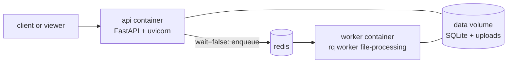
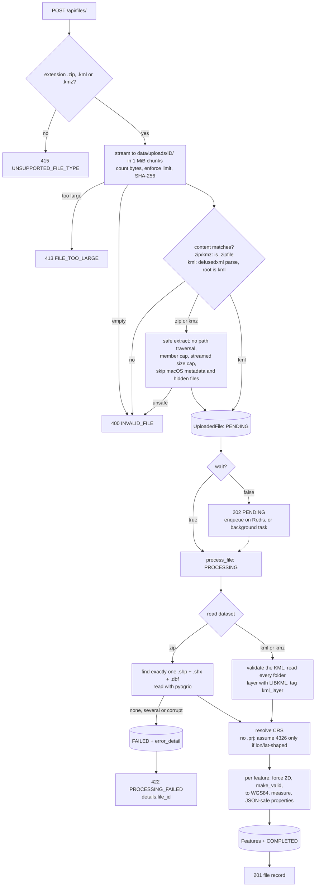
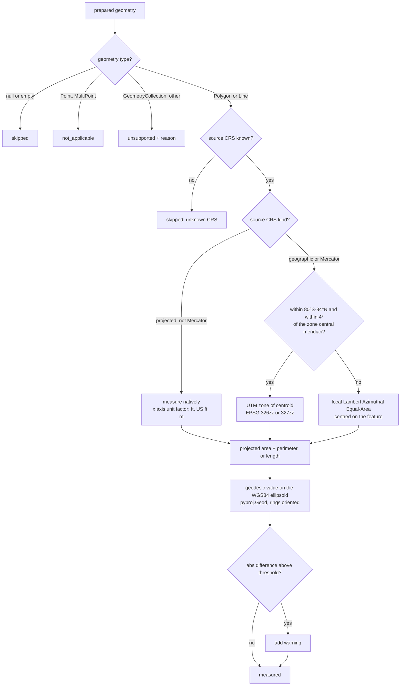
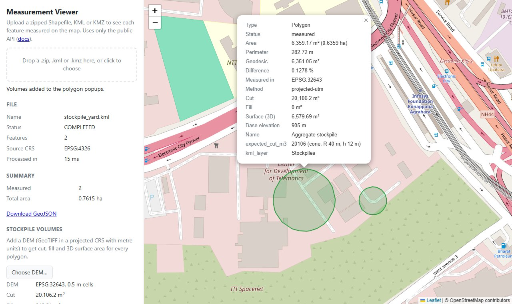

# Geospatial File Measurement API

[](.github/workflows/ci.yml)
[](pyproject.toml)
[](LICENSE)

A FastAPI service that accepts a **zipped Shapefile**, **KML** or **KMZ** file, extracts every
feature, and returns **area** for polygons and **length** for lines. Each value is computed in
a projected CRS chosen per feature, then cross-checked against the exact geodesic value on the
WGS84 ellipsoid. Given a drone **DEM**, it also computes **stockpile volumes and 3D surface
area** for each polygon.


*The bundled map viewer, built only on the public API. Parcel P-002 is a 200 m square with a
50 m courtyard. It measures 37,552.53 m² in UTM 43N against a geodesic 37,499.86 m²; the 0.14%
difference is UTM's known scale error at this distance from the zone's central meridian.*

## Highlights

- **Never measures in degrees.** Each feature is projected to its own UTM zone. An equal-area
  fallback covers polar and very wide features, and Web Mercator input is detected and
  reprojected.
- **Every number is checked.** Each projected value comes with the geodesic value and the
  percentage difference between them. Tested from 89°S to 89°N, the difference stays under
  0.25%. The common shortcuts fall apart away from the equator: for a 1 km² plot at Oslo,
  Web Mercator is +297%, "degrees × 111.32 km" is +99% and one fixed UTM zone for every
  feature is +25% ([accuracy report](#accuracy-validation)).
- **Stockpile volumes from a DEM.** Cut, fill and net volume and 3D surface area per polygon.
  On the sample yard it matches closed-form cone volumes to within 0.004%.
- **Production shape.** Synchronous or queued processing (Redis + RQ workers), Alembic
  migrations, request ids, GeoJSON export, Docker Compose stack, and CI running ruff, mypy,
  pytest with a coverage gate and a full-stack smoke test.
- **Safe with untrusted files.** Guards against zip slip, zip bombs, XXE, oversized uploads and
  GDAL file indirection, with one error body shape everywhere ([threat model](SECURITY.md)).
- **172 tests at 98% coverage**, using independent ground truth: geodesics walked on the
  ellipsoid and closed-form shapes, never the code under test.

## Quick start

```bash
docker compose up --build        # API, Redis and a processing worker
```

Then open:
- <http://localhost:8000/> for the map viewer: drop in `sample_data/bengaluru_parcels.zip`, or
  `sample_data/stockpile_yard.kml` followed by its DEM;
- <http://localhost:8000/docs> for the interactive OpenAPI docs.

```bash
curl -F "file=@sample_data/bengaluru_survey.kml" http://localhost:8000/api/files/
```

---

## Contents

1. [Setup](#setup)
2. [API](#api)
3. [Architecture](#architecture)
4. [CRS handling](#crs-handling)
5. [Stockpile volumes](#stockpile-volumes)
6. [Accuracy validation](#accuracy-validation)
7. [Map viewer](#map-viewer)
8. [Engineering practices](#engineering-practices)
9. [Design decisions](#design-decisions)
10. [Known limitations](#known-limitations)
11. [Learnings](#learnings)
12. [Future scope](#future-scope)

---

## Setup

Requires **Python 3.11+**. The geospatial wheels (`pyogrio`, `shapely`, `pyproj`, `rasterio`)
bundle GDAL, GEOS and PROJ, so you don't need to install any system libraries.

### Local (virtualenv)

```bash
python3.11 -m venv .venv
source .venv/bin/activate           # Windows: .venv\Scripts\activate
pip install -r requirements-dev.txt

uvicorn app.main:create_app --factory --reload
# Viewer: http://localhost:8000/    Docs: http://localhost:8000/docs
```

Without Redis, `?wait=false` uploads run as in-process background tasks, so local
development needs no other services. The database schema is created and migrated
automatically on startup.

### Docker

```bash
docker compose up --build          # full stack: api + redis + worker, sharing one data volume
```

Or run the API container on its own:

```bash
docker build -t geospatial-measurement-api .
docker run --rm -p 8000:8000 -v geoapi-data:/data geospatial-measurement-api
```

The image runs as a non-root user, keeps SQLite and uploads in the `/data` volume, and has a
`HEALTHCHECK` on `/health`.

### Tasks

| Task | `make` | Without `make` (e.g. Windows) |
|---|---|---|
| Install (+ pre-commit hooks) | `make install` | `pip install -r requirements-dev.txt && pre-commit install` |
| Run | `make run` | `uvicorn app.main:create_app --factory --reload` |
| Full stack | `make up` | `docker compose up --build` |
| Lint + types + tests | `make check` | `ruff check . && ruff format --check . && mypy && pytest --cov` |
| Tests with coverage | `make test` | `python -m pytest -q --cov --cov-report=term-missing` |
| New migration | `make migration m="add x"` | `alembic revision --autogenerate -m "add x"` |
| Accuracy report | `make accuracy` | `python -m scripts.accuracy_report` |
| Regenerate sample data | `make sample-data` | `python -m scripts.make_sample_data` |

### Configuration

Every setting can be overridden with a `GEOAPI_` environment variable ([app/config.py](app/config.py),
[.env.example](.env.example)):

| Variable | Default | Purpose |
|---|---|---|
| `GEOAPI_DATA_DIR` | `data` | Where the SQLite database and uploads live |
| `GEOAPI_DATABASE_URL` | `sqlite:///<data_dir>/geoapi.db` | Any SQLAlchemy URL |
| `GEOAPI_MAX_UPLOAD_BYTES` | `52428800` (50 MiB) | Upload limit for files and DEMs (413 above it) |
| `GEOAPI_MAX_UNCOMPRESSED_BYTES` | `524288000` (500 MiB) | Zip-bomb limit on extracted bytes |
| `GEOAPI_MAX_ARCHIVE_MEMBERS` | `200` | Maximum number of files in a zip or KMZ |
| `GEOAPI_MAX_DEM_CELLS_PER_FEATURE` | `25000000` | DEM cells one polygon may cover |
| `GEOAPI_GEODESIC_WARNING_PCT` | `0.5` | Projected vs geodesic difference that triggers a warning |
| `GEOAPI_REDIS_URL` | unset | Queue `?wait=false` uploads on Redis for RQ workers |
| `GEOAPI_JOB_TIMEOUT_SECONDS` | `600` | Maximum run time of a queued job |
| `GEOAPI_LOG_LEVEL` | `INFO` | Application log level |

---

## API

Interactive docs are at `/docs`. Every response below was captured from the running app
processing the files in [sample_data/](sample_data/). Those files are produced by
[scripts/make_sample_data.py](scripts/make_sample_data.py), so their true sizes and volumes
are known by construction.

| Method | Path | Success | Errors |
|---|---|---|---|
| `POST` | `/api/files/` | `201` file record (`202` with `?wait=false`) | `400` invalid content, `413` too large, `415` wrong type, `422` processing failed, `503` queue unavailable |
| `GET` | `/api/files/` | `200` paginated list (`limit`, `offset`) | `422` bad query |
| `GET` | `/api/files/{id}/` | `200` file record | `404` |
| `GET` | `/api/files/{id}/measurements/` | `200` features + summary | `404`, `409` not COMPLETED, `422` bad query |
| `GET` | `/api/files/{id}/geojson/` | `200` `application/geo+json` FeatureCollection | `404`, `409` |
| `POST` | `/api/files/{id}/volumes/` | `200` volumes and 3D surface area from a DEM | `400` invalid DEM, `404`, `409`, `413` |
| `DELETE` | `/api/files/{id}/` | `204` | `404` |
| `GET` | `/health` | `200 {"status": "ok", "queue": "redis" \| "in-process"}` | |

Every response carries an `X-Request-ID` header. A safe client-supplied value is echoed back;
otherwise one is generated. The same id appears in the server log line for the request.

### Upload a file

```bash
curl -F "file=@sample_data/bengaluru_survey.kml" http://localhost:8000/api/files/
```

`201 Created`

```json
{
    "id": "a9e6587b-56eb-412c-87e9-77db7f3ced99",
    "filename": "bengaluru_survey.kml",
    "format": "kml",
    "status": "COMPLETED",
    "feature_count": 5,
    "crs": "EPSG:4326",
    "crs_assumed": false,
    "geometry_type_counts": {
        "Polygon": 1,
        "LineString": 1,
        "Point": 3
    },
    "warnings": [],
    "error_detail": null,
    "size_bytes": 1289,
    "sha256": "420b751a56ee0f094509bb5c6482f6c9db5a341f9cc5e54019b93b2b91b1acbc",
    "processing_time_ms": 33,
    "created_at": "2026-10-11T16:35:53.984380Z"
}
```

A Shapefile is uploaded as a `.zip`: the `.shp` can be at any depth inside it, and `.shx`
and `.dbf` must sit next to it. A `.kmz` (zipped KML, as Google Earth exports) works the same
way; its `doc.kml`, or its only `.kml` file, is read.

#### Queued processing

With `?wait=false` the upload is validated and stored, `202` comes back straight away, and
the file is processed by an RQ worker (or an in-process task when Redis isn't configured):

```bash
curl -F "file=@sample_data/bengaluru_parcels.zip" "http://localhost:8000/api/files/?wait=false"
```

`202 Accepted`

```json
{
    "id": "2e0a9dae-8377-45ff-8d55-2db613a00a22",
    "filename": "bengaluru_parcels.zip",
    "format": "shapefile",
    "status": "PENDING",
    "feature_count": 0,
    "crs": null,
    "crs_assumed": false,
    "geometry_type_counts": {},
    "warnings": [],
    "error_detail": null,
    "size_bytes": 1404,
    "sha256": "0007fe3366ccafeadd8711e11c3268c532074a1f05fd3e0889ca4164207734bc",
    "processing_time_ms": null,
    "created_at": "2026-10-11T16:35:54.055061Z"
}
```

Polling `GET /api/files/2e0a9dae-8377-45ff-8d55-2db613a00a22/` a moment later returns the
same record with `"status": "COMPLETED"`, `"feature_count": 3`, `"crs": "EPSG:4326"` and
`"processing_time_ms": 16`. A processing failure shows up as `"status": "FAILED"` with
`error_detail`, because there is no longer a request to return a 422 to.

### Measurements

| Parameter | Default | Meaning |
|---|---|---|
| `limit` | `50` | Page size, 1–500 |
| `offset` | `0` | Number of items to skip |
| `geometry_type` | none | `Point`, `MultiPoint`, `LineString`, `MultiLineString`, `Polygon`, `MultiPolygon` or `GeometryCollection` |
| `include_geometry` | `true` | Include GeoJSON; set `false` for lighter responses |

The `summary` covers every feature that matches the filter, not just the current page.

```bash
curl "http://localhost:8000/api/files/a9e6587b-56eb-412c-87e9-77db7f3ced99/measurements/?limit=2&include_geometry=false"
```

`200 OK`

```json
{
    "file_id": "a9e6587b-56eb-412c-87e9-77db7f3ced99",
    "filename": "bengaluru_survey.kml",
    "status": "COMPLETED",
    "crs": "EPSG:4326",
    "total": 5,
    "limit": 2,
    "offset": 0,
    "summary": {
        "feature_count": 5,
        "measured": 2,
        "not_applicable": 3,
        "skipped": 0,
        "unsupported": 0,
        "total_area_m2": 1001268.01,
        "total_area_ha": 100.1268,
        "total_length_m": 2001.171,
        "total_length_km": 2.001171
    },
    "items": [
        {
            "index": 0,
            "source_fid": null,
            "geometry_type": "Polygon",
            "measured_geometry_type": "Polygon",
            "repaired": false,
            "source_crs": "EPSG:4326",
            "geometry_crs": "EPSG:4326",
            "properties": {
                "Name": "Survey block (1 km x 1 km)",
                "expected": "100 ha",
                "kml_layer": "Site boundary"
            },
            "geometry": null,
            "measurement": {
                "status": "measured",
                "reason": null,
                "area_m2": 1001268.01,
                "area_ha": 100.1268,
                "perimeter_m": 4002.535,
                "length_m": null,
                "length_km": null,
                "measurement_crs": "EPSG:32643",
                "method": "projected-utm",
                "geodesic": {
                    "area_m2": 999982.13,
                    "perimeter_m": 3999.964,
                    "length_m": null
                },
                "difference_pct": 0.1286,
                "warnings": []
            }
        },
        {
            "index": 1,
            "source_fid": null,
            "geometry_type": "LineString",
            "measured_geometry_type": "LineString",
            "repaired": false,
            "source_crs": "EPSG:4326",
            "geometry_crs": "EPSG:4326",
            "properties": {
                "Name": "Haul road (2 km due east)",
                "expected": "2.000 km",
                "kml_layer": "Haul roads",
                "surface": "gravel"
            },
            "geometry": null,
            "measurement": {
                "status": "measured",
                "reason": null,
                "area_m2": null,
                "area_ha": null,
                "perimeter_m": null,
                "length_m": 2001.171,
                "length_km": 2.001171,
                "measurement_crs": "EPSG:32643",
                "method": "projected-utm",
                "geodesic": {
                    "area_m2": null,
                    "perimeter_m": null,
                    "length_m": 2000.0
                },
                "difference_pct": 0.0585,
                "warnings": [
                    "Z values were dropped; measurements are planimetric (2D)."
                ]
            }
        }
    ]
}
```

`measurement.status` is one of:

| Status | When |
|---|---|
| `measured` | Polygon/MultiPolygon (area + perimeter) or LineString/MultiLineString (length) |
| `not_applicable` | Point/MultiPoint: there is nothing to measure |
| `skipped` | Null or empty geometry, or the source CRS is unknown |
| `unsupported` | Any other type, e.g. GeometryCollection. Reported with a reason, never a 500 |

### GeoJSON export

`GET /api/files/{id}/geojson/` returns all features (optionally filtered by `geometry_type`) as
an RFC 7946 FeatureCollection with `Content-Type: application/geo+json`. It opens directly in
QGIS or [geojson.io](https://geojson.io). The measurement fields are flat properties and the
source attributes sit under `attributes`:

```json
{
    "type": "Feature",
    "id": 1,
    "geometry": {
        "type": "LineString",
        "coordinates": [[77.592, 12.9763], [77.61043402225499, 12.976299346970771]]
    },
    "properties": {
        "index": 1,
        "source_fid": null,
        "geometry_type": "LineString",
        "repaired": false,
        "status": "measured",
        "reason": null,
        "area_m2": null,
        "area_ha": null,
        "perimeter_m": null,
        "length_m": 2001.171,
        "length_km": 2.001171,
        "measurement_crs": "EPSG:32643",
        "method": "projected-utm",
        "geodesic_area_m2": null,
        "geodesic_length_m": 2000.0,
        "difference_pct": 0.0585,
        "warnings": ["Z values were dropped; measurements are planimetric (2D)."],
        "attributes": {
            "Name": "Haul road (2 km due east)",
            "expected": "2.000 km",
            "kml_layer": "Haul roads",
            "surface": "gravel"
        }
    }
}
```

GeoJSON coordinates must be WGS84. A feature whose source CRS is unknown is therefore exported
with `"geometry": null`, rather than at a wrong location.

### Stockpile volumes from a DEM

`POST /api/files/{id}/volumes/` takes a GeoTIFF DEM as the multipart field `dem`, plus an
optional `base` query parameter (`boundary-mean` by default, or `boundary-min`). See
[Stockpile volumes](#stockpile-volumes) for how it works.

```bash
curl -F "file=@sample_data/stockpile_yard.kml" http://localhost:8000/api/files/
curl -F "dem=@sample_data/stockpile_yard_dem.tif" \
  http://localhost:8000/api/files/190a8395-506a-40aa-8e4d-d136cbafd3d2/volumes/
```

`200 OK`

```json
{
    "file_id": "190a8395-506a-40aa-8e4d-d136cbafd3d2",
    "base_method": "boundary-mean",
    "dem": {
        "crs": "EPSG:32643",
        "cell_size_m": [0.5, 0.5],
        "width": 400,
        "height": 400
    },
    "totals": {
        "cut_volume_m3": 20106.2,
        "fill_volume_m3": 942.51,
        "net_volume_m3": 19163.68
    },
    "items": [
        {
            "index": 0,
            "measured": true,
            "reason": null,
            "base_elevation_m": 905.0,
            "cut_volume_m3": 20106.2,
            "fill_volume_m3": 0.0,
            "net_volume_m3": 20106.2,
            "surface_area_m2": 6579.69,
            "planimetric_area_m2": 6360.0,
            "dem_coverage_pct": 100.0,
            "warnings": []
        },
        {
            "index": 1,
            "measured": true,
            "reason": null,
            "base_elevation_m": 905.0,
            "cut_volume_m3": 0.0,
            "fill_volume_m3": 942.51,
            "net_volume_m3": -942.51,
            "surface_area_m2": 1280.17,
            "planimetric_area_m2": 1256.0,
            "dem_coverage_pct": 100.0,
            "warnings": []
        }
    ]
}
```

Feature 0 is a conical stockpile (R 40 m, h 12 m) and feature 1 a conical pit (R 15 m, depth
4 m). Their exact volumes are 20,106.19 m³ and 942.48 m³.

### Errors

Every error, including validation errors and unknown routes, uses one shape:

```bash
curl -F "file=@notes.txt" http://localhost:8000/api/files/
```

`415 Unsupported Media Type`

```json
{"error":{"code":"UNSUPPORTED_FILE_TYPE","message":"Unsupported file type '.txt'. Upload a .zip containing a Shapefile, a .kml or a .kmz file.","details":{"supported_extensions":[".kml",".kmz",".zip"]}}}
```

A zip that is valid but contains no Shapefile is **stored as FAILED**. Its id comes back in the
error, so the record can still be inspected (`GET /api/files/{id}/` shows `"status": "FAILED"`
and the same `error_detail`):

`422 Unprocessable Entity`

```json
{"error":{"code":"PROCESSING_FAILED","message":"No .shp file found in the archive. Files found: readme.txt.","details":{"file_id":"85e53911-6871-42e6-a1a9-50720dca9022"}}}
```

Asking for that file's measurements, GeoJSON or volumes returns `409`:

```json
{"error":{"code":"FILE_NOT_READY","message":"File has no measurements because its status is FAILED.","details":{"file_id":"85e53911-6871-42e6-a1a9-50720dca9022","status":"FAILED"}}}
```

An unknown id (or a malformed one, since ids are opaque) returns `404`:

```json
{"error":{"code":"NOT_FOUND","message":"File '00000000-0000-0000-0000-000000000000' was not found.","details":{}}}
```

---

## Architecture

### Application structure

```
app/
  main.py            app factory: routers, error envelope, upload-size guard, request ids, viewer
  config.py          settings (pydantic-settings, GEOAPI_* env vars)
  db.py              session factory; applies Alembic migrations on startup
  errors.py          AppError hierarchy -> HTTP status + stable error code
  api/               thin routes: files, health, dependencies (DB session, get-file-or-404)
  schemas/           Pydantic response models with OpenAPI examples; GeoJSON and volume reports
  models/            SQLAlchemy ORM: UploadedFile 1-* Feature
  migrations/        Alembic environment and versioned schema migrations
  services/
    ingest.py        type/size/content validation, streamed storage + SHA-256, safe unzip,
                     find the .shp or the KMZ's main document
    reader.py        Shapefile/KML -> GeoDataFrame, missing-CRS policy, geometry repair,
                     JSON-safe properties
    crs.py           CRS labelling, measurement-CRS selection, cached transformers
    measure.py       projected measurement + geodesic cross-check
    volumes.py       DEM cut/fill/net volume and 3D surface area
    processing.py    pipeline orchestration and status transitions
    jobs.py          queued processing: Redis/RQ, or in-process background tasks
    results.py       read-side queries: pagination, filters, SQL summary
  static/viewer/     single-file Leaflet map viewer (no build step)
scripts/
  make_sample_data.py   deterministic sample files with sizes and volumes known by construction
  accuracy_report.py    the accuracy table below
tests/                  172 tests; fixtures are generated in tmp_path
```

Routes contain no logic. Services don't know about HTTP, apart from raising typed `AppError`s.
The measurement code (`crs.py`, `measure.py`, `volumes.py`) consists of pure functions over
geometries and arrays, tested without a database or HTTP.

### Deployment



### File-processing flow



Bad *requests* (wrong type, too large, not a zip or KML) are rejected before anything is stored.
*Content* problems (no `.shp`, corrupt data) are stored as `FAILED`, so the upload can still be
inspected by id.

### Measurement flow



---

## CRS handling

### Why you can't measure in degrees

A degree of longitude is 111.32 km at the equator and 0 km at the poles. A degree of latitude
is also slightly different everywhere, because the Earth is an ellipsoid. So "square degrees" is
not a unit of area: treating degrees as fixed 111.32 km squares overstates a 1 km² plot at Oslo
by 99%. Coordinates have to be put into a metric, projected CRS first.
`test_area_is_never_computed_in_degrees` would fail if that ever regressed.

### How the measurement CRS is chosen ([app/services/crs.py](app/services/crs.py))

| Source CRS | Measured in | `method` |
|---|---|---|
| Projected and suitable (UTM, state plane, national grids) | The source CRS itself, with units converted to metres via the CRS's axis unit factor (international feet = 0.3048 m; US survey feet = 1200/3937 m) | `native` |
| Geographic (e.g. EPSG:4326), or Mercator / Web Mercator | The **UTM zone of the feature's centroid**: zone = ⌊(lon + 180) / 6⌋ + 1, EPSG 326zz (north) or 327zz (south) | `projected-utm` |
| Geographic, but outside 80°S–84°N or more than 4° from the zone's central meridian | A **Lambert Azimuthal Equal-Area** projection centred on the feature | `projected-laea-fallback` |
| Unknown (no `.prj`, coordinates not lon/lat-shaped) | Not measured | `skipped` |

Why each rule:

- **Native projected CRS.** Survey data from a drone or GNSS workflow is usually already in UTM
  or a local grid that the surveyor chose on purpose. Reprojecting it into another zone would
  only add error.
- **Mercator is the exception.** EPSG:3857 is projected, but it inflates areas by roughly
  1/cos²(lat): +5.9% at Bengaluru and +297% at Oslo. Mercator-family sources are therefore
  reprojected, with a warning. Transverse Mercator (which is what UTM is) and Oblique Mercator
  are not affected.
- **UTM per feature.** UTM is conformal, EPSG-coded and familiar to every surveyor. Its scale
  factor is 0.9996 on the central meridian and grows to about 1.001 at the zone edge, which
  keeps the area error under about 0.2% inside the zone. Choosing per feature, not per file,
  matters: measuring everything in one fixed UTM zone is off by +25% at Oslo when that zone is
  Bengaluru's.
- **The 4° rule.** UTM scale error grows with the square of the distance from the central
  meridian (k ≈ 0.9996·(1 + (Δλ·cos φ)²/2)). Allowing features to reach 4° from it (1° into the
  neighbouring zone) caps the area error at about 0.4% at the equator, and less at higher
  latitudes. Beyond that, the code switches to LAEA, which preserves area exactly at any size.
- **Poles.** UTM is undefined beyond 84°N and 80°S, so LAEA is used there too.
- **Axis order.** EPSG:4326 is formally *(lat, lon)*. Every transformer is built with
  `always_xy=True`, so coordinates stay *(lon, lat)* as GeoJSON and shapely expect.

### Why the geodesic cross-check exists

The projected value is the primary measurement. Every projection distorts something, though,
and the most accurate number available is the geodesic one: area and length computed directly
on the WGS84 ellipsoid (GeographicLib, through `pyproj.Geod`). The API reports both, plus
`difference_pct = (projected − geodesic) / geodesic × 100`, and adds a warning above
`GEOAPI_GEODESIC_WARNING_PCT` (default 0.5%). This turns "trust me, it was projected" into a
number that can be checked for every feature. It also guards against cases the rules above
don't cover, such as a source CRS that is used far outside its intended area.

Two details had to be right for the geodesic values to be correct:

- `Geod.geometry_area_perimeter` signs each ring's area by its winding order. Polygons are
  normalised with `shapely.orient_polygons` first, so holes are always subtracted.
- pyproj's polygon perimeter counts only the exterior ring, while the projected perimeter counts
  holes too. The geodesic perimeter therefore sums every ring, so the two values are compared
  like with like.

---

## Stockpile volumes



Volumetrics are the core of drone surveys in mining and aggregates: how much material is in a
stockpile, and how much was excavated. `POST /api/files/{id}/volumes/` computes them for every
measured polygon in a file from a DEM ([app/services/volumes.py](app/services/volumes.py)).

1. Each polygon (the stockpile *toe*) is transformed from WGS84 into the DEM's CRS, and only
   the window of DEM cells around it is read.
2. Cells whose centres fall inside the polygon are selected. Nodata cells are excluded and
   reported through `dem_coverage_pct`, with a warning when coverage is incomplete.
3. A horizontal **base plane** is set from DEM samples taken along the polygon boundary, once
   per cell width: their mean (`boundary-mean`, the usual toe-average method) or their lowest
   point (`boundary-min`, a conservative base on sloping ground).
4. With *z* the cell elevation and *A* the cell area:
   - **cut** = Σ max(z − base, 0)·A, the material above the base;
   - **fill** = Σ max(base − z, 0)·A, the void below it, such as a pit;
   - **net** = cut − fill;
   - **3D surface area** = Σ A·√(1 + (∂z/∂x)² + (∂z/∂y)²), from the DEM's gradient.

DEMs are untrusted uploads too. The file must start with a TIFF signature and is opened with
GDAL's GeoTIFF driver *only*, so a crafted VRT can't make GDAL read other files on the server.
The DEM must be in a projected CRS with metre units, so that cell sizes and elevations share
one unit. Each polygon may cover at most `GEOAPI_MAX_DEM_CELLS_PER_FEATURE` cells. Nothing is
stored: the DEM is deleted when the request finishes.

---

## Accuracy validation

### Sample data (from the running app)

The sample features are built by walking geodesics of known length on the ellipsoid. This makes
their size independent of any projection. All three Bengaluru sites are in UTM zone 43N, whose
central meridian is 75°E.

| Feature (sample file) | Location | Intended size | Projected (UTM 43N) | Geodesic (WGS84) | Difference |
|---|---|---|---|---|---|
| P-001, 100 m square (`bengaluru_parcels.zip`) | Cubbon Park, 77.59°E | 10,000 m² | 10,011.56 m² | 9,999.98 m² | +0.1158% |
| P-002, 200 m square with 50 m hole | Whitefield, 77.75°E | 37,500 m² | 37,552.53 m² | 37,499.86 m² | +0.1405% |
| P-002 perimeter (outer + hole) | | 1,000 m | 1,000.701 m | 999.998 m | |
| P-003, 1 km square | Electronic City, 77.67°E | 1,000,000 m² | 1,001,268.01 m² | 999,982.13 m² | +0.1286% |
| Haul road, 2 km due east (`bengaluru_survey.kml`) | Cubbon Park, 77.59°E | 2,000 m | 2,001.171 m | 2,000.000 m | +0.0585% |

What the numbers show:

- **The geodesic values match the intended sizes** to within 0.002%. A "square" walked along
  geodesics doesn't close perfectly on a curved surface, so its last side is slightly short.
- **The UTM error follows the theory.** All three sites are about 2.6–2.75° east of the central
  meridian, where UTM's scale factor is about 1.0006. Areas scale with k², so they come out about
  0.12–0.14% high, and the figure grows with distance from 75°E. Length scales with k, not k²,
  so the road is off by about half as much.
- `bengaluru_parcels_utm43n.zip` holds the same parcels already in EPSG:32643. It returns
  identical areas with `method: "native"`, confirming that the native path and the
  reprojection path agree.

### Around the world, compared with common shortcuts

`make accuracy` ([scripts/accuracy_report.py](scripts/accuracy_report.py)) builds a 1 km² plot
(or a large box) at each site and reports each method's error against the geodesic area:

| Site | Measured in | This service | Web Mercator | Fixed UTM 43N | Degrees × 111.32 km |
|---|---|---|---|---|---|
| Equator, on a central meridian (3°E) | EPSG:32631 | -0.080% | +0.674% | +1018.921% | +0.675% |
| Equator, 2.9° from the central meridian | EPSG:32631 | +0.179% | +0.674% | +723.497% | +0.675% |
| Bengaluru (77.59°E, 12.97°N) | EPSG:32643 | +0.117% | +5.948% | +0.117% | +3.243% |
| Oslo (10.75°E, 59.91°N) | EPSG:32632 | -0.056% | +296.617% | +25.473% | +98.823% |
| Ushuaia (68.30°W, 54.80°S) | EPSG:32719 | -0.075% | +200.215% | +13.399% | +73.075% |
| Svalbard, 85°N (beyond UTM) | local LAEA | -0.000% | +13001.177% | +0.491% | +1040.835% |
| Wide feature, 8.5° × 1° near India | local LAEA | -0.134% | +5.391% | +0.184% | +2.892% |

How to read it:
- **This service** stays within ±0.18% everywhere.
- **The −0.080% on a central meridian** is exactly UTM's built-in 0.9996² scale.
- **Each shortcut** is fine in one place and badly wrong elsewhere.
- **The wide feature's −0.134%** comes from how its edges are interpreted, not from
  projection error (see Known limitations).

### Volumes against closed-form solids

The stockpile yard in `sample_data/` is flat ground with a cone and a conical pit at 0.5 m
resolution. The response above, compared with the exact formulas:

| Quantity | Exact | Computed | Difference |
|---|---|---|---|
| Stockpile cut volume, πR²h/3 (R 40 m, h 12 m) | 20,106.19 m³ | 20,106.20 m³ | +0.0000% |
| Pit fill volume, πR²h/3 (R 15 m, h 4 m) | 942.48 m³ | 942.51 m³ | +0.0034% |
| Stockpile 3D surface area (flat toe + πR√(R²+h²)) | 6,581.32 m² | 6,579.69 m² | −0.0248% |
| Pit 3D surface area | 1,280.70 m² | 1,280.17 m² | −0.0415% |

The small surface-area deficit comes from the finite-difference gradient smoothing the cone's
sharp apex and rim.

### Tests

[tests/test_measure.py](tests/test_measure.py) asserts accuracy across a **grid of 24 sites**
(eight latitudes from 79.5°S to 83.5°N × three positions across a zone) and at four polar
sites. It also covers:
- one degree of longitude at the equator;
- polygons with holes, with either winding order;
- native metres, international feet and US survey feet;
- Web Mercator input;
- axis order.

[tests/test_volumes.py](tests/test_volumes.py) checks:
- a cone and a pit against πR²h/3;
- the cone's 3D surface against its slant-surface formula;
- both base methods on a 5% slope, where the boundary-minimum wedge must equal 3.5 m × area;
- partial DEM coverage and polygons outside the DEM;
- rejection of geographic, CRS-less and non-TIFF DEMs.

---

## Map viewer

`/viewer/` (and `/`, which redirects there) serves a single HTML file,
[app/static/viewer/index.html](app/static/viewer/index.html). You can drop in a file and see
every feature on an OpenStreetMap basemap:
- colour shows the measurement status;
- clicking a feature shows its projected and geodesic values, the CRS it was measured in,
  warnings and source attributes;
- choosing a DEM adds cut, fill and 3D surface area to the polygons;
- recent uploads are listed, and `?file=<id>` links can be shared.

It deliberately uses **only the public API**, so it doubles as a working example of a client.

- **No build step.** Vanilla JS and Leaflet 1.9.4 from a CDN, pinned with Subresource Integrity
  hashes.
- **Untrusted text is never parsed as HTML.** KML names and attributes come from uploaded files,
  so the page only ever sets them with `textContent`. A headless-browser check with a placemark
  named `` showed it as plain text, and no script ran.
- **Verified end to end in headless Chromium:** upload, map, popups, volumes, error display
  and shareable links. Both screenshots come from those runs.

---

## Engineering practices

| Area | Practice |
|---|---|
| Quality gates | `make check`: ruff (lint + format), mypy with `disallow_untyped_defs`, pytest with a 95% coverage gate (currently 98%) |
| CI | GitHub Actions: lint, type-check and test, then build the Compose stack and smoke-test a synchronous upload and a queued one that the worker must complete |
| Pre-commit | ruff, mypy and file-hygiene hooks ([.pre-commit-config.yaml](.pre-commit-config.yaml)) |
| Dependencies | Exact pins in `requirements*.txt`; Dependabot for pip, GitHub Actions and the Docker base image |
| Database | Alembic migrations applied on startup; `tests/test_migrations.py` fails if models and migrations drift |
| Testing | Independent ground truth (geodesics, closed-form solids); every fixture generated in `tmp_path` by [tests/factories.py](tests/factories.py) |
| Reproducibility | Sample data and the accuracy table come from scripts; regenerating sample data is byte-identical |
| Observability | Request ids in headers and logs; per-file processing time; `/health` reports the queue backend |
| Security | Threat model and private reporting in [SECURITY.md](SECURITY.md) |
| Contributing | Setup, conventions and commit style in [CONTRIBUTING.md](CONTRIBUTING.md); issue and PR templates; [CHANGELOG.md](CHANGELOG.md) |

---

## Design decisions

**FastAPI rather than Django + DRF.**
- The service is a small API with no admin, auth or server-rendered pages, so Django's breadth
  would mostly go unused.
- FastAPI gives typed request and response models with Pydantic v2, OpenAPI docs generated from
  those same types, and dependency injection that makes the database and settings easy to swap
  in tests.
- Django would win with a back-office UI, or with GeoDjango plus PostGIS as the main store.

**Synchronous by default; queued on request, with RQ rather than Celery.**
- `POST` processes in the request by default, so a client gets results in one call. A
  2,000-polygon Shapefile processed in 0.58 s locally.
- `?wait=false` hands the work to `processing.process_in_background`, which opens its own DB
  session. With `GEOAPI_REDIS_URL` set, an RQ job runs it in a worker process, so queued work
  survives API restarts and scales by adding workers. Without Redis, the same function runs as
  a FastAPI background task, keeping local development dependency-free.
- **RQ over Celery:** the queue has one job type and needs no scheduling, routing or result
  backend. RQ is a small library on top of Redis that a reader can understand in an afternoon.
- If Redis is unreachable, the upload fails fast with `503` and the file is marked `FAILED`,
  instead of sitting in `PENDING` forever.

**SQLite rather than PostGIS.**
- One file, zero setup, and enough for this workload.
- The app never queries geometry spatially: features are filtered by type and paginated by
  index. A spatial database would add operational weight without being used.
- PostGIS becomes the right choice once you need spatial queries ("what intersects this
  site?"), spatial indexes, or many concurrent writers. SQLAlchemy and Alembic keep that move
  contained.

**Per-feature UTM, rather than one CRS per file, pure geodesic, or LAEA everywhere.**
- *One CRS per file* breaks for files spanning several zones (see the "Fixed UTM 43N" column).
- *Pure geodesic* would be the most accurate, but a projected measurement is what surveyors
  reproduce in their own tools, so geodesic is kept as validation.
- *LAEA everywhere* would preserve area at any size and needs no zone logic. It loses because
  each feature then gets a one-off projection with no EPSG code, which surveyors can't reproduce
  in QGIS or ArcGIS, and because it isn't conformal, so lengths drift away from the centre.
- UTM gives a standard, reproducible `EPSG:326zz` for nearly every feature, and LAEA covers the
  cases UTM handles badly.

**Use a projected source CRS as-is, except for Mercator.**
- Reprojecting UTM into another UTM zone, or a state plane into UTM, only adds distortion.
- Web Mercator is the common case where "projected" doesn't mean "measurable", so it is
  detected explicitly.
- Anything else unsuitable is caught by the geodesic warning.

**Volumes: a horizontal base plane from the toe, computed on request.**
- The boundary-sampled base plane is the standard first-order method in survey software. It
  needs nothing beyond the DEM and the toe polygon.
- A TIN base surface (triangulating the toe) would handle stockpiles on uneven ground better;
  it is listed under future scope.
- Results aren't stored: the same polygons are often measured against successive surveys, so
  the DEM is the input that changes, and storing derived volumes would add schema without a
  query that needs it.

**GeoJSON in a JSON column, rather than native geometry columns.**
- The API returns GeoJSON (RFC 7946, WGS84), so storing it that way means no conversion on
  read, and no SpatiaLite or PostGIS dependency.
- Measurement values are real columns, not part of a JSON blob, so the `geometry_type` filter
  and the summary totals are plain SQL aggregates.

**Extract archives to disk, rather than reading them in place with GDAL `/vsizip/`.**
- `/vsizip/` avoids writing files and makes zip-slip impossible.
- But GDAL would then decompress on demand, using sizes from the zip headers, which can lie.
- Extracting with streamed byte counting gives a zip-bomb limit that the archive can't cheat,
  lets the code check the KML inside a KMZ with `defusedxml` before GDAL sees it, and produces
  clear "found X, Y" errors.

**Failure semantics.**
- Invalid requests return `400`/`413`/`415` and are **not stored**. Nothing useful exists to
  look up, and storing them would let junk fill the disk.
- Content that can't be processed returns `422` and is **stored as `FAILED`** with
  `error_detail`. The body uses the same error envelope as everything else, with
  `details.file_id`, so there is one error shape and the record is still retrievable.
- Reading results of a file that isn't `COMPLETED` returns `409`.
- Malformed ids return `404`, not `422`: ids are opaque to clients.

**Missing `.prj`: assume, but only when it's safe, and say so.**
- If every coordinate is within ±180/±90, EPSG:4326 is assumed, and both `crs_assumed: true`
  and a warning are set.
- Otherwise the CRS is unknown: features are kept, measurement is `skipped`, and the geometry is
  returned in source coordinates with `geometry_crs: null`.
- Guessing a projected CRS from coordinate ranges is how wrong numbers get reported with false
  confidence.

**Geometry repair.**
- Invalid polygons are fixed with `shapely.make_valid(method="structure")` and flagged with
  `repaired: true` and a warning.
- The default method can turn a bow-tie into a `GeometryCollection` (polygons plus stray lines),
  which would lose its area. The `structure` method keeps the result polygonal, so a bow-tie
  becomes a `MultiPolygon`.
- The source type and the measured type are both reported.

**KML through GDAL's LIBKML driver, rather than fastkml.**
- One reader stack (pyogrio) for every format.
- LIBKML reads folders as layers and `ExtendedData` as attributes.
- Its rendering hints (`tessellate`, `extrude`, `visibility`, …) are dropped because they
  describe display, not data.

**Migrations on startup.**
- With one service and one database, applying migrations when the app starts removes a manual
  deployment step.
- In Compose, the worker waits for the API to be healthy, so only one process migrates at a
  time.
- A larger deployment would run `alembic upgrade head` as a separate release step instead.

**A viewer with no front-end framework.** It is one HTML file of about 330 lines, including
its CSS, with no build step. It is a demo and a reference client, not a product, so a
framework and a bundler would cost more than they add.

**Numbers are rounded at the API edge.** The database keeps full precision. Responses round to
0.01 m², 0.01 m³ and 1 mm, which is already finer than any survey input can justify.

---

## Known limitations

- **Antimeridian-crossing features.** Their lon/lat bounds and centroid are wrong, which can pick
  the wrong zone or fallback. The input usually needs splitting at ±180° first.
- **Very large features.** Straight edges in lon/lat, geodesic edges and straight edges in a
  projection are different lines, and nothing is densified. For an 8.5° × 1° box the LAEA and
  geodesic areas differ by −0.13%, from how the edges are interpreted rather than from the
  projection.
- **Planimetric file measurements.** Z values in uploaded files are dropped; 3D surface area
  comes from a DEM through the volumes endpoint.
- **Volume base surface.** The base is a horizontal plane. On strongly uneven ground a
  triangulated (TIN) base would be more accurate. Elevations are assumed to be in metres, like
  the DEM's horizontal units.
- **Summary totals are sums.** Overlapping polygons are counted once each; this is not a union
  area.
- **The missing-`.prj` heuristic** could mistake a local engineering grid with small coordinates
  for lon/lat. `crs_assumed: true` and a warning make this visible.
- **Unsuitable projected CRSs other than Mercator** (e.g. equirectangular in metres) are
  measured natively. The geodesic warning flags them; the code doesn't fix them.
- **GeometryCollections are not measured,** even when they contain polygons. They are reported
  as `unsupported`.
- **Queue without Redis.** Without `GEOAPI_REDIS_URL`, background work runs in-process and is
  lost if the server restarts mid-task. A crashed RQ job lands in RQ's failed-job registry
  rather than being retried.
- **SQLite with several writers.** The API and the worker share one SQLite file, which is fine
  at this scale; Postgres is the next step for heavier write loads.
- **The GeoJSON export is not paginated,** so very large files produce large responses.
- **The viewer needs internet access** for OpenStreetMap tiles and the Leaflet CDN.
- **One Shapefile per zip.**
- UTM's special zones for Norway and Svalbard are ignored. This is harmless, because the zone
  is only used as a measurement CRS.

---

## Learnings

Problems that came up while building this, and what they taught:

- **An "ignore hidden files" rule can hide a path-traversal attack.** The first zip-slip test
  failed: `../../evil.txt` was silently *skipped*, because `".."` starts with a dot. Nothing
  escaped, but a malicious archive should be rejected loudly, not quietly filtered. The order
  of checks matters.
- **Cross-checks only work if both sides measure the same thing.** pyproj's polygon perimeter
  counts only the exterior ring, while shapely's `length` includes holes. The mismatch only
  showed up when reading real output for the polygon with a hole (800 m vs 1,000 m), because no
  test compared perimeters.
- **Ground truth needs checking too.** A test asserted that Web Mercator inflates area by
  exactly 1/cos²φ. It failed: the real figure is about 5.9%, not 5.3%, because pseudo-Mercator
  applies spherical formulas to ellipsoidal latitudes. The expectation was wrong, not the code.
- **UTM isn't exact even at its centre**, and the size of the effect matters: −0.08% on the
  central meridian, +0.12–0.14% at Bengaluru.
- **Shortcuts fail by orders of magnitude, not percent.** One fixed CRS for everything is
  +1,019% at the equator when the CRS was meant for India.
- **Merging KML layers creates fake attributes.** Stacking folders gave every placemark nulls
  for fields that only exist in other folders.
- **GDAL opens more than you ask it to.** Without a driver restriction, an uploaded "DEM" could
  be a VRT that points GDAL at other files on the server. Checking the TIFF signature and
  pinning the GeoTIFF driver closes that door.
- **Screenshots find bugs that tests don't.** Browser runs showed that popups had dropped the
  feature's own attributes, and that a longer label broke the drop zone's layout because a
  `<label>` is inline by default.
- **Reproducible artefacts need fixed timestamps.** Zip entries carry modification times, so
  regenerated sample data changed on every run until the archives were written with a fixed
  date.

---

## Future scope

- **PostGIS** with GiST spatial indexes, for spatial queries across files ("which parcels
  intersect this haul road?") and native geometry storage.
- **TIN base surfaces and survey-to-survey comparison** for volumes: triangulate the toe as the
  base, and difference two DEMs of the same site to report change in stockpile volume over
  time.
- **Point clouds:** compute DEMs and volumes directly from drone LAS/LAZ point clouds.
- **More formats:** GeoPackage, GeoJSON and DXF. pyogrio already reads them; the work is in
  validation and tests.
- **Object storage** (S3/GCS) for uploads and DEMs, with pre-signed upload URLs so large files
  bypass the API.
- **Auth and multi-tenancy:** API keys or OAuth, with files scoped per organisation.
- **Large-file streaming:** read features in batches (pyogrio supports Arrow streams), insert in
  bulk, and stream the GeoJSON export.
- **De-duplication** using the stored SHA-256: return the existing result for a re-upload.
- **Job retries** with backoff for transient failures in queued processing.

## License

[MIT](LICENSE)
