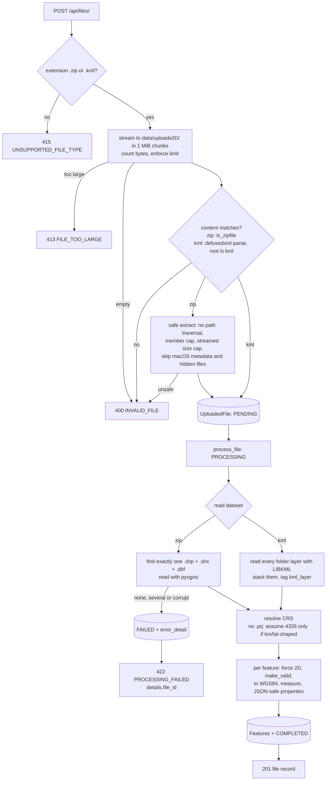
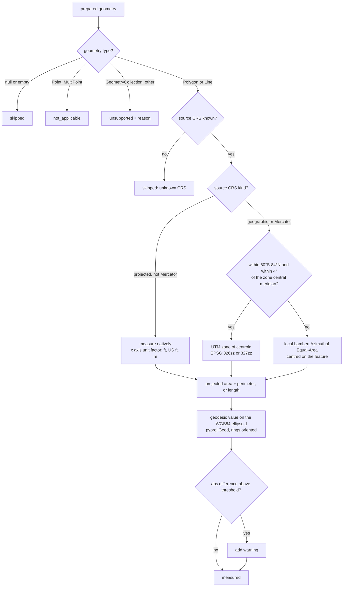

# Geospatial File Measurement API

A FastAPI service that accepts a **zipped Shapefile** or a **KML** file, extracts every feature,
and returns **area** for polygons and **length** for lines. Each value is computed in a projected
CRS chosen per feature, and then cross-checked against the exact geodesic value on the WGS84
ellipsoid.

```
POST /api/files/                     upload + process
GET  /api/files/{id}/                file information
GET  /api/files/{id}/measurements/   per-feature measurements + summary
```

Main points:

- **Never measures in degrees.** Geographic coordinates are projected to the feature's UTM zone.
  An equal-area fallback covers polar features and very wide ones.
- **Every measurement is validated.** The projected value (primary, as the brief asks) is
  reported next to the geodesic value and the percentage difference between them. A warning is
  raised past a configurable threshold.
- **Safe on untrusted uploads.** It guards against zip-slip and zip bombs and parses KML in a
  way that is safe from XXE. Size limits are enforced. Every error uses the same body shape.
- **Tested against independent ground truth.** 106 tests. Shapes are built by walking geodesics,
  not drawn in the projection being tested.

---

## Contents

- [Setup](#setup)
- [API](#api)
- [Architecture](#architecture)
- [CRS handling](#crs-handling)
- [Accuracy validation](#accuracy-validation)
- [Design decisions](#design-decisions)
- [Known limitations](#known-limitations)
- [Learnings](#learnings)
- [Future scope](#future-scope)

---

## Setup

Requires **Python 3.11+**. The geospatial wheels (`pyogrio`, `shapely`, `pyproj`) bundle GDAL,
GEOS and PROJ, so you don't need to install any system libraries.

### Local (virtualenv)

```bash
python3.11 -m venv .venv
source .venv/bin/activate           # Windows: .venv\Scripts\activate
pip install -r requirements-dev.txt

uvicorn app.main:create_app --factory --reload
# Interactive docs: http://localhost:8000/docs
```

### Docker

```bash
docker build -t geospatial-measurement-api .
docker run --rm -p 8000:8000 -v geoapi-data:/data geospatial-measurement-api
```

The image runs as a non-root user, keeps the SQLite database and uploads in the `/data`
volume, and has a `HEALTHCHECK` on `/health`.

### Tests and lint

| Task | `make` | Without `make` (e.g. Windows) |
|---|---|---|
| Install | `make install` | `pip install -r requirements-dev.txt` |
| Run | `make run` | `uvicorn app.main:create_app --factory --reload` |
| Test | `make test` | `python -m pytest -q` |
| Lint | `make lint` | `ruff check . && ruff format --check .` |
| Regenerate sample data | `make sample-data` | `python -m scripts.make_sample_data` |

CI (GitHub Actions) runs the lint and tests. It then builds the Docker image and smoke-tests it
by uploading `sample_data/bengaluru_survey.kml` to the running container.

### Configuration

Every setting can be overridden with a `GEOAPI_` environment variable
([app/config.py](app/config.py)):

| Variable | Default | Purpose |
|---|---|---|
| `GEOAPI_DATA_DIR` | `data` | Where the SQLite database and uploads live |
| `GEOAPI_DATABASE_URL` | `sqlite:///<data_dir>/geoapi.db` | Any SQLAlchemy URL |
| `GEOAPI_MAX_UPLOAD_BYTES` | `52428800` (50 MiB) | Upload limit (413 above it) |
| `GEOAPI_MAX_UNCOMPRESSED_BYTES` | `524288000` (500 MiB) | Zip-bomb limit on extracted bytes |
| `GEOAPI_MAX_ARCHIVE_MEMBERS` | `200` | Maximum number of files in a zip |
| `GEOAPI_GEODESIC_WARNING_PCT` | `0.5` | Projected vs geodesic difference that triggers a warning |

---

## API

Interactive OpenAPI docs are served at `/docs`. Every response below was captured from the
Docker container processing the files in [sample_data/](sample_data/). Those files are
generated by [scripts/make_sample_data.py](scripts/make_sample_data.py), so their true sizes are
known by construction.

| Method | Path | Success | Errors |
|---|---|---|---|
| `POST` | `/api/files/` | `201` file record | `400` invalid content, `413` too large, `415` wrong type, `422` processing failed |
| `GET` | `/api/files/` | `200` paginated list (`limit`, `offset`) | `422` bad query |
| `GET` | `/api/files/{id}/` | `200` file record | `404` |
| `GET` | `/api/files/{id}/measurements/` | `200` features + summary | `404`, `409` file not COMPLETED, `422` bad query |
| `DELETE` | `/api/files/{id}/` | `204` | `404` |
| `GET` | `/health` | `200 {"status":"ok"}` | |

### Upload a file

```bash
curl -F "file=@sample_data/bengaluru_survey.kml" http://localhost:8000/api/files/
```

`201 Created`

```json
{
    "id": "56672a78-907f-4c84-a44b-80fa39ca9e26",
    "filename": "bengaluru_survey.kml",
    "format": "kml",
    "status": "COMPLETED",
    "feature_count": 5,
    "crs": "EPSG:4326",
    "crs_assumed": false,
    "geometry_type_counts": {
        "Polygon": 1,
        "LineString": 1,
        "Point": 3
    },
    "warnings": [],
    "error_detail": null,
    "created_at": "2026-10-10T19:17:48.169701Z"
}
```

A Shapefile is uploaded the same way, as a `.zip`. The `.shp` can be at any depth inside it,
and `.shx` and `.dbf` must sit next to it:

```bash
curl -F "file=@sample_data/bengaluru_parcels.zip" http://localhost:8000/api/files/
```

### File information

```bash
curl http://localhost:8000/api/files/56672a78-907f-4c84-a44b-80fa39ca9e26/
```

`200 OK`: the same body as the upload response above.

### Measurements

Query parameters:

| Parameter | Default | Meaning |
|---|---|---|
| `limit` | `50` | Page size, 1–500 |
| `offset` | `0` | Number of items to skip |
| `geometry_type` | none | `Point`, `MultiPoint`, `LineString`, `MultiLineString`, `Polygon`, `MultiPolygon` or `GeometryCollection` |
| `include_geometry` | `true` | Include GeoJSON; set `false` for lighter responses |

The `summary` covers every feature that matches the filter, not just the current page.

```bash
curl "http://localhost:8000/api/files/56672a78-907f-4c84-a44b-80fa39ca9e26/measurements/?limit=2&include_geometry=false"
```

`200 OK`

```json
{
    "file_id": "56672a78-907f-4c84-a44b-80fa39ca9e26",
    "filename": "bengaluru_survey.kml",
    "status": "COMPLETED",
    "crs": "EPSG:4326",
    "total": 5,
    "limit": 2,
    "offset": 0,
    "summary": {
        "feature_count": 5,
        "measured": 2,
        "not_applicable": 3,
        "skipped": 0,
        "unsupported": 0,
        "total_area_m2": 1001268.01,
        "total_area_ha": 100.1268,
        "total_length_m": 2001.171,
        "total_length_km": 2.001171
    },
    "items": [
        {
            "index": 0,
            "source_fid": null,
            "geometry_type": "Polygon",
            "measured_geometry_type": "Polygon",
            "repaired": false,
            "source_crs": "EPSG:4326",
            "geometry_crs": "EPSG:4326",
            "properties": {
                "Name": "Survey block (1 km x 1 km)",
                "expected": "100 ha",
                "kml_layer": "Site boundary"
            },
            "geometry": null,
            "measurement": {
                "status": "measured",
                "reason": null,
                "area_m2": 1001268.01,
                "area_ha": 100.1268,
                "perimeter_m": 4002.535,
                "length_m": null,
                "length_km": null,
                "measurement_crs": "EPSG:32643",
                "method": "projected-utm",
                "geodesic": {
                    "area_m2": 999982.13,
                    "perimeter_m": 3999.964,
                    "length_m": null
                },
                "difference_pct": 0.1286,
                "warnings": []
            }
        },
        {
            "index": 1,
            "source_fid": null,
            "geometry_type": "LineString",
            "measured_geometry_type": "LineString",
            "repaired": false,
            "source_crs": "EPSG:4326",
            "geometry_crs": "EPSG:4326",
            "properties": {
                "Name": "Haul road (2 km due east)",
                "expected": "2.000 km",
                "kml_layer": "Haul roads",
                "surface": "gravel"
            },
            "geometry": null,
            "measurement": {
                "status": "measured",
                "reason": null,
                "area_m2": null,
                "area_ha": null,
                "perimeter_m": null,
                "length_m": 2001.171,
                "length_km": 2.001171,
                "measurement_crs": "EPSG:32643",
                "method": "projected-utm",
                "geodesic": {
                    "area_m2": null,
                    "perimeter_m": null,
                    "length_m": 2000.0
                },
                "difference_pct": 0.0585,
                "warnings": [
                    "Z values were dropped; measurements are planimetric (2D)."
                ]
            }
        }
    ]
}
```

A point, with its geometry (`?geometry_type=Point&limit=1`):

```json
{
    "index": 2,
    "source_fid": null,
    "geometry_type": "Point",
    "measured_geometry_type": "Point",
    "repaired": false,
    "source_crs": "EPSG:4326",
    "geometry_crs": "EPSG:4326",
    "properties": {
        "Name": "GCP-1",
        "kml_layer": "Ground control points"
    },
    "geometry": {
        "type": "Point",
        "coordinates": [77.59660850557127, 12.976299959185674]
    },
    "measurement": {
        "status": "not_applicable",
        "reason": "Points have no area or length.",
        "area_m2": null,
        "area_ha": null,
        "perimeter_m": null,
        "length_m": null,
        "length_km": null,
        "measurement_crs": null,
        "method": null,
        "geodesic": null,
        "difference_pct": null,
        "warnings": []
    }
}
```

`measurement.status` is one of:

| Status | When |
|---|---|
| `measured` | Polygon/MultiPolygon (area + perimeter) or LineString/MultiLineString (length) |
| `not_applicable` | Point/MultiPoint: the brief requires no measurement |
| `skipped` | Null or empty geometry, or the source CRS is unknown |
| `unsupported` | Any other type, e.g. GeometryCollection. Reported with a reason, never a 500 |

### Errors

Every error, including validation errors and unknown routes, uses one shape:

```bash
curl -F "file=@notes.txt" http://localhost:8000/api/files/
```

`415 Unsupported Media Type`

```json
{"error":{"code":"UNSUPPORTED_FILE_TYPE","message":"Unsupported file type '.txt'. Upload a .zip containing a Shapefile or a .kml file.","details":{"supported_extensions":[".kml",".zip"]}}}
```

A zip that is valid but contains no Shapefile is **stored as FAILED**. Its id comes back in the
error, so the record can still be inspected:

`422 Unprocessable Entity`

```json
{"error":{"code":"PROCESSING_FAILED","message":"No .shp file found in the archive. Files found: readme.txt.","details":{"file_id":"8a8d93d7-e3df-497d-838f-75e475c97831"}}}
```

```bash
curl http://localhost:8000/api/files/8a8d93d7-e3df-497d-838f-75e475c97831/
```

```json
{
    "id": "8a8d93d7-e3df-497d-838f-75e475c97831",
    "filename": "docs.zip",
    "format": "shapefile",
    "status": "FAILED",
    "feature_count": 0,
    "crs": null,
    "crs_assumed": false,
    "geometry_type_counts": {},
    "warnings": [],
    "error_detail": "No .shp file found in the archive. Files found: readme.txt.",
    "created_at": "2026-10-10T19:18:00.082277Z"
}
```

Asking for that file's measurements returns `409`:

```json
{"error":{"code":"FILE_NOT_READY","message":"File has no measurements because its status is FAILED.","details":{"file_id":"8a8d93d7-e3df-497d-838f-75e475c97831","status":"FAILED"}}}
```

An unknown id (or a malformed one, since ids are opaque) returns `404`:

```json
{"error":{"code":"NOT_FOUND","message":"File '00000000-0000-0000-0000-000000000000' was not found.","details":{}}}
```

---

## Architecture

### Application structure

```
app/
  main.py            app factory, router registration, error envelope, upload-size guard
  config.py          settings (pydantic-settings, GEOAPI_* env vars)
  db.py              engine + session factory (SQLite, foreign keys on)
  errors.py          AppError hierarchy -> HTTP status + stable error code
  api/
    files.py         thin routes: parse request, call a service, shape the response
    deps.py          DB session, settings, get-file-or-404
    health.py
  schemas/           Pydantic response models (with OpenAPI examples)
  models/            SQLAlchemy ORM: UploadedFile 1-* Feature
  services/
    ingest.py        type/size/content validation, streamed storage, safe unzip, find the .shp
    reader.py        Shapefile/KML -> GeoDataFrame, missing-CRS policy, geometry repair, JSON-safe props
    crs.py           CRS labelling, measurement-CRS selection, cached transformers
    measure.py       projected measurement + geodesic cross-check
    processing.py    pipeline orchestration and status transitions
    results.py       read-side queries: pagination, filters, SQL summary
scripts/make_sample_data.py   reproducible sample files
tests/                        106 tests; fixtures are generated in tmp_path
```

Routes contain no logic. Services don't know about HTTP, apart from raising typed `AppError`s.
The geometry code (`crs.py`, `measure.py`) consists of pure functions that are tested without
a database or HTTP.

### File-processing flow



Bad *requests* (wrong type, too large, not a zip or KML) are rejected before anything is stored.
*Content* problems (no `.shp`, corrupt data) are stored as `FAILED`, so the upload can still be
inspected by id.

### Measurement flow



---

## CRS handling

### Why you can't measure in degrees

A degree of longitude is 111.32 km at the equator and 0 km at the poles. A degree of latitude
is also slightly different everywhere, because the Earth is an ellipsoid. So "square degrees" is
not a unit of area. The 1 km² test square near Bengaluru measures about `8e-5` in square degrees,
and that number means nothing on its own. Coordinates have to be put into a metric, projected
CRS first, as the brief requires. The test
`test_area_is_never_computed_in_degrees` would fail if that ever regressed.

### How the measurement CRS is chosen ([app/services/crs.py](app/services/crs.py))

| Source CRS | Measured in | `method` |
|---|---|---|
| Projected and suitable (UTM, state plane, national grids) | The source CRS itself, with units converted to metres via the CRS's axis unit factor (international feet = 0.3048 m; US survey feet = 1200/3937 m) | `native` |
| Geographic (e.g. EPSG:4326), or Mercator / Web Mercator | The **UTM zone of the feature's centroid**: zone = ⌊(lon + 180) / 6⌋ + 1, EPSG 326zz (north) or 327zz (south) | `projected-utm` |
| Geographic, but outside 80°S–84°N or more than 4° from the zone's central meridian | A **Lambert Azimuthal Equal-Area** projection centred on the feature | `projected-laea-fallback` |
| Unknown (no `.prj`, coordinates not lon/lat-shaped) | Not measured | `skipped` |

Why each rule:

- **Native projected CRS.** Survey data from a drone or GNSS workflow is usually already in UTM
  or a local grid that the surveyor chose on purpose. Reprojecting it into another zone would
  only add error.
- **Mercator is the exception.** EPSG:3857 is projected, but it inflates areas by roughly
  1/cos²(lat). For our Bengaluru test square it would overstate the area by **5.9%** (asserted in
  `test_web_mercator_input_is_not_measured_natively`). Mercator-family sources are therefore
  reprojected, with a warning. Transverse Mercator (which is what UTM is) and Oblique Mercator are
  not affected.
- **UTM per feature.** UTM is conformal, EPSG-coded and familiar to every surveyor. Its
  scale factor is 0.9996 on the central meridian and grows to about 1.001 at the zone edge. That
  keeps the area error under about 0.2% inside the zone. Choosing per feature, not per file,
  means a file that spans several zones is still measured correctly everywhere.
- **The 4° rule.** UTM scale error grows with the square of the distance from the central
  meridian (k ≈ 0.9996·(1 + (Δλ·cos φ)²/2)). Allowing features to reach 4° from it (1° into the
  neighbouring zone) caps the area error at about 0.4% at the equator, and less at higher
  latitudes. Beyond that, the code
  switches to LAEA, which preserves area exactly at any size.
- **Poles.** UTM is undefined beyond 84°N and 80°S, so LAEA is used there too.
- **Axis order.** EPSG:4326 is formally *(lat, lon)*. Every transformer is built with
  `always_xy=True`, so coordinates stay *(lon, lat)* as GeoJSON and shapely expect.
  `test_axis_order_is_lon_lat` checks a known point.

### Why the geodesic cross-check exists

The brief asks for a projected measurement, so that is the primary value. Every projection
distorts something, though, and the most accurate number available is the geodesic one: area
and length computed directly on the WGS84 ellipsoid (GeographicLib, through `pyproj.Geod`). The
API reports both, plus `difference_pct = (projected − geodesic) / geodesic × 100`, and adds a
warning above `GEOAPI_GEODESIC_WARNING_PCT` (default 0.5%). This turns "trust me, I projected it"
into a number that can be checked for every feature. It also guards against anything the rules
above don't cover, such as a source CRS that is used far outside its intended area.

Two details had to be right for the geodesic values to be correct:

- `Geod.geometry_area_perimeter` signs each ring's area by its winding order. Polygons are
  normalised with `shapely.orient_polygons` first, so holes are always subtracted.
- pyproj's polygon perimeter counts only the exterior ring, while the projected perimeter counts
  holes too. The geodesic perimeter therefore sums every ring, so the two values are compared
  like with like.

---

## Accuracy validation

The sample features are built by walking geodesics of known length on the ellipsoid. This makes
their size independent of any projection. All three Bengaluru sites are in UTM zone 43N, whose
central meridian is 75°E.

| Feature (sample file) | Location | Intended size | Projected (UTM 43N) | Geodesic (WGS84) | Difference |
|---|---|---|---|---|---|
| P-001, 100 m square (`bengaluru_parcels.zip`) | Cubbon Park, 77.59°E | 10,000 m² | 10,011.56 m² | 9,999.98 m² | +0.1158% |
| P-002, 200 m square with 50 m hole | Whitefield, 77.75°E | 37,500 m² | 37,552.53 m² | 37,499.86 m² | +0.1405% |
| P-002 perimeter (outer + hole) | | 1,000 m | 1,000.701 m | 999.998 m | |
| P-003, 1 km square | Electronic City, 77.67°E | 1,000,000 m² | 1,001,268.01 m² | 999,982.13 m² | +0.1286% |
| Haul road, 2 km due east (`bengaluru_survey.kml`) | Cubbon Park, 77.59°E | 2,000 m | 2,001.171 m | 2,000.000 m | +0.0585% |

What the numbers show:

- **The geodesic values match the intended sizes** to within 0.002%. A "square" walked along
  geodesics doesn't close perfectly on a curved surface, so its last side is slightly short.
  The geodesic column is the exact area of the polygon as stored.
- **The UTM error follows the theory.** All three sites are about 2.6–2.75° east of the central
  meridian, where UTM's scale factor is about 1.0006. Areas scale with k², so they come out about
  0.12–0.14% high. The figure grows with distance from 75°E: Cubbon Park < Electronic City <
  Whitefield. Length scales with k, not k², so the road is off by about half as much (0.06%).
- The same 1 km square moved to 75°E, the central meridian, measures **−0.0800%**. That is
  exactly UTM's built-in 0.9996² scale. (Obtained by running `measure()` directly.)
- `bengaluru_parcels_utm43n.zip` holds the same parcels already in EPSG:32643. It returns
  identical areas with `method: "native"`, confirming that the native path and the
  reprojection path agree.

All of these differences are well inside the 0.5% warning threshold. Surveyors who need the
best possible number for a feature can read `measurement.geodesic`.

### Test coverage of the CRS logic

[tests/test_measure.py](tests/test_measure.py) and [tests/test_crs.py](tests/test_crs.py) cover:

- a 1 km square at Bengaluru and on the central meridian;
- a 5 km line;
- one degree of longitude at the equator (geodesic 111,319.49 m);
- a polygon with a hole (with matching winding, which a naive approach gets wrong);
- native metres, international feet and US survey feet (EPSG:2227);
- Web Mercator;
- a polar feature (LAEA);
- a feature too wide for UTM (LAEA);
- the southern hemisphere (EPSG:327zz);
- axis order;
- the degrees guard.

---

## Design decisions

**FastAPI rather than Django + DRF.**
- The service is a small API with no admin, auth or server-rendered pages, so Django's breadth
  would mostly go unused.
- FastAPI gives typed request and response models with Pydantic v2, OpenAPI docs generated from
  those same types, and dependency injection that makes the database and settings easy to swap
  in tests.
- Django would win with a back-office UI, or with GeoDjango plus PostGIS as the main store.

**Synchronous processing, behind one function.**
- `POST` processes in the request because the files here are small. A 2,000-polygon Shapefile
  processed in 0.58 s locally (Windows, in-process test client). Synchronous processing also
  means a client gets its measurements in one call.
- All content work lives in `processing.process_file(db, file_id, settings)`, and the route
  marks the one place where it would be queued instead.
- Moving to FastAPI `BackgroundTasks`, or Celery/RQ on Redis, is a small, contained change, but
  it is more than one line:
  - `POST` returns `202` with `status: PENDING`;
  - the worker needs its own DB session, not the request's;
  - the upload already sits on disk under a server-generated id, so it outlives the request;
  - clients poll `GET /api/files/{id}/` instead of reading a `422`, since failures surface as
    `status: FAILED`.
- The `PENDING → PROCESSING → COMPLETED/FAILED` statuses already exist for this reason.

**SQLite rather than PostGIS.**
- One file, zero setup, and enough for this workload.
- The app never queries geometry spatially: features are filtered by type and paginated by
  index. A spatial database would add operational weight without being used.
- PostGIS becomes the right choice as soon as you need spatial queries (what intersects this
  site?), spatial indexes, or concurrent writers. SQLAlchemy keeps that move contained.

**Per-feature UTM, rather than one CRS per file, pure geodesic, or LAEA everywhere.**
- *One CRS per file* breaks for files spanning several zones, or a whole state.
- *Pure geodesic* would be the most accurate, but the brief explicitly asks for a projected CRS,
  so geodesic is kept as validation.
- *LAEA everywhere* would preserve area at any size and needs no zone logic. It loses because
  each feature then gets a one-off projection with no EPSG code, which surveyors can't reproduce
  in QGIS or ArcGIS, and because it isn't conformal, so lengths drift away from the centre.
- UTM gives a standard, reproducible `EPSG:326zz` for nearly every feature, and LAEA covers the
  cases UTM handles badly.

**Use a projected source CRS as-is, except for Mercator.**
- Reprojecting UTM into another UTM zone, or a state plane into UTM, only adds distortion.
- Web Mercator is the common case where "projected" doesn't mean "measurable", so it is
  detected explicitly.
- Anything else unsuitable is caught by the geodesic warning.

**GeoJSON in a JSON column, rather than native geometry columns.**
- The API returns GeoJSON (RFC 7946, WGS84), so storing it that way means no conversion on
  read, and no SpatiaLite or PostGIS dependency.
- Measurement values are real columns, not part of a JSON blob, so the `geometry_type` filter
  and the summary totals are plain SQL aggregates.

**Extract the zip to disk, rather than reading it in place with GDAL `/vsizip/`.**
- `/vsizip/` avoids writing files and makes zip-slip impossible.
- But GDAL would then decompress on demand, using sizes from the zip headers, which can lie.
- Extracting with streamed byte counting gives a zip-bomb limit that the archive can't cheat,
  and lets the code inspect the file list to produce clear "found X, Y" errors.

**Failure semantics.**
- Invalid requests return `400`/`413`/`415` and are **not stored**. Nothing useful exists to
  look up, and storing them would let junk fill the disk.
- Content that can't be processed returns `422` and is **stored as `FAILED`** with
  `error_detail`. The body uses the same error envelope as everything else, with
  `details.file_id`, so there is one error shape and the record is still retrievable.
- Measurements for a file that isn't `COMPLETED` return `409`.
- Malformed ids return `404`, not `422`: ids are opaque to clients.

**Missing `.prj`: assume, but only when it's safe, and say so.**
- If every coordinate is within ±180/±90, EPSG:4326 is assumed, and both `crs_assumed: true`
  and a warning are set.
- Otherwise the CRS is unknown: features are kept, measurement is `skipped`, and the geometry is
  returned in source coordinates with `geometry_crs: null`.
- Guessing a projected CRS from coordinate ranges is how wrong numbers get reported with false
  confidence.

**Geometry repair.**
- Invalid polygons are fixed with `shapely.make_valid(method="structure")` and flagged with
  `repaired: true` and a warning.
- The default method can turn a bow-tie into a `GeometryCollection` (polygons plus stray lines),
  which would lose its area. The `structure` method keeps the result polygonal, so a bow-tie
  becomes a `MultiPolygon`.
- The source type and the measured type are both reported.

**KML through GDAL's LIBKML driver, rather than fastkml.**
- One reader stack (pyogrio) for both formats.
- LIBKML reads folders as layers and `ExtendedData` as attributes.
- Its rendering hints (`tessellate`, `extrude`, `visibility`, …) are dropped because they
  describe display, not data.
- Before GDAL sees the file, it is parsed with `defusedxml`, which rejects entity declarations
  (XXE and billion-laughs attacks).

**Numbers are rounded at the API edge.** The database keeps full precision. Responses round to
0.01 m² and 1 mm, which is already finer than any survey input can justify.

---

## Known limitations

- **Antimeridian-crossing features.** Their lon/lat bounds and centroid are wrong, which can pick
  the wrong zone or fallback. The input usually needs splitting at ±180° first.
- **Very large features.** Straight edges in lon/lat, geodesic edges and straight edges in a
  projection are different lines, and nothing is densified. For an 8.5° × 1° box the LAEA and
  geodesic areas differ by −0.13%, from how the edges are interpreted rather than from the
  projection.
- **Planimetric only.** Z values are dropped and areas are 2D. For stockpiles or terrain the
  real surface area is larger, and it needs a DEM (see Future scope).
- **Summary totals are sums.** Overlapping polygons are counted once each; this is not a
  union area.
- **The missing-`.prj` heuristic** could mistake a local engineering grid with small coordinates
  for lon/lat. `crs_assumed: true` and a warning make this visible.
- **Unsuitable projected CRSs other than Mercator** (e.g. equirectangular in metres) are
  measured natively. The geodesic warning flags them; the code doesn't fix them.
- **GeometryCollections are not measured,** even when they contain polygons. They are reported
  as `unsupported`.
- **One Shapefile per zip; no KMZ.**
- **Synchronous processing** ties up a worker for the duration of an upload, and SQLite allows
  one writer at a time. Both are fine at this scale, and both are listed under Future scope.
- UTM's special zones for Norway and Svalbard are ignored. This is harmless, because the zone
  is only used as a measurement CRS.

---

## Learnings

> **DRAFT. To be rewritten in my own words.** Each point below is something that actually came
> up while building this.

- **An "ignore hidden files" rule hid a path-traversal attack.** The first zip-slip test failed:
  `../../evil.txt` was silently *skipped*, because `".."` starts with a dot. Nothing escaped, but
  a malicious archive should be rejected loudly, not quietly filtered. Order of checks matters.
- **Cross-checks only work if both sides measure the same thing.** pyproj's polygon perimeter
  counts only the exterior ring, while shapely's `length` includes holes. The bug only showed up
  when I read the real output for the polygon with a hole (800 m vs 1,000 m). No existing test
  compared perimeters.
- **My own ground truth can be wrong.** I asserted Web Mercator inflates area by exactly
  1/cos²φ. The test failed: it's about 5.9%, not 5.3%, because pseudo-Mercator applies
  spherical formulas to ellipsoidal latitudes. I changed the expectation, not the code.
- **UTM isn't exact even at its centre.** Measuring against geodesic values made this concrete:
  −0.08% on the central meridian, +0.12–0.14% at Bengaluru. The error depends on where the site
  sits in its zone.
- **Merging KML layers creates fake attributes.** Stacking folders gave every placemark nulls
  for fields that only exist in other folders. That's harmless for a table, but wrong for a
  per-feature properties object.
- **Formats limit what tests can generate.** DBF has no datetime type: GDAL wrote my timestamp
  column as a string. I tested date handling on a GeoDataFrame instead of pretending the
  round-trip worked.

---

## Future scope

- **PostGIS** with GiST spatial indexes, for spatial queries across files ("which parcels
  intersect this haul road?") and native geometry storage.
- **Async workers with Redis** (Celery or RQ). `POST` returns `202`, a worker calls
  `process_file`, and progress and failures are reported through the status field.
- **More formats:** GeoPackage, GeoJSON, KMZ and DXF. pyogrio already reads most of them; the
  work is in validation and tests.
- **Object storage** (S3/GCS) for uploads, with pre-signed upload URLs so large files bypass
  the API.
- **Surface area and volume** from a DEM or drone point cloud, which is what stockpile and
  terrain analytics actually need.
- **Map preview:** a small Leaflet or MapLibre page that draws a file's features coloured by
  measurement status.
- **Auth and multi-tenancy:** API keys or OAuth, with files scoped per organisation.
- **Large-file streaming:** read features in batches (pyogrio supports Arrow streams) and write
  them in bulk, instead of holding one GeoDataFrame.
- **Database migrations** with Alembic, once the schema starts to evolve.
